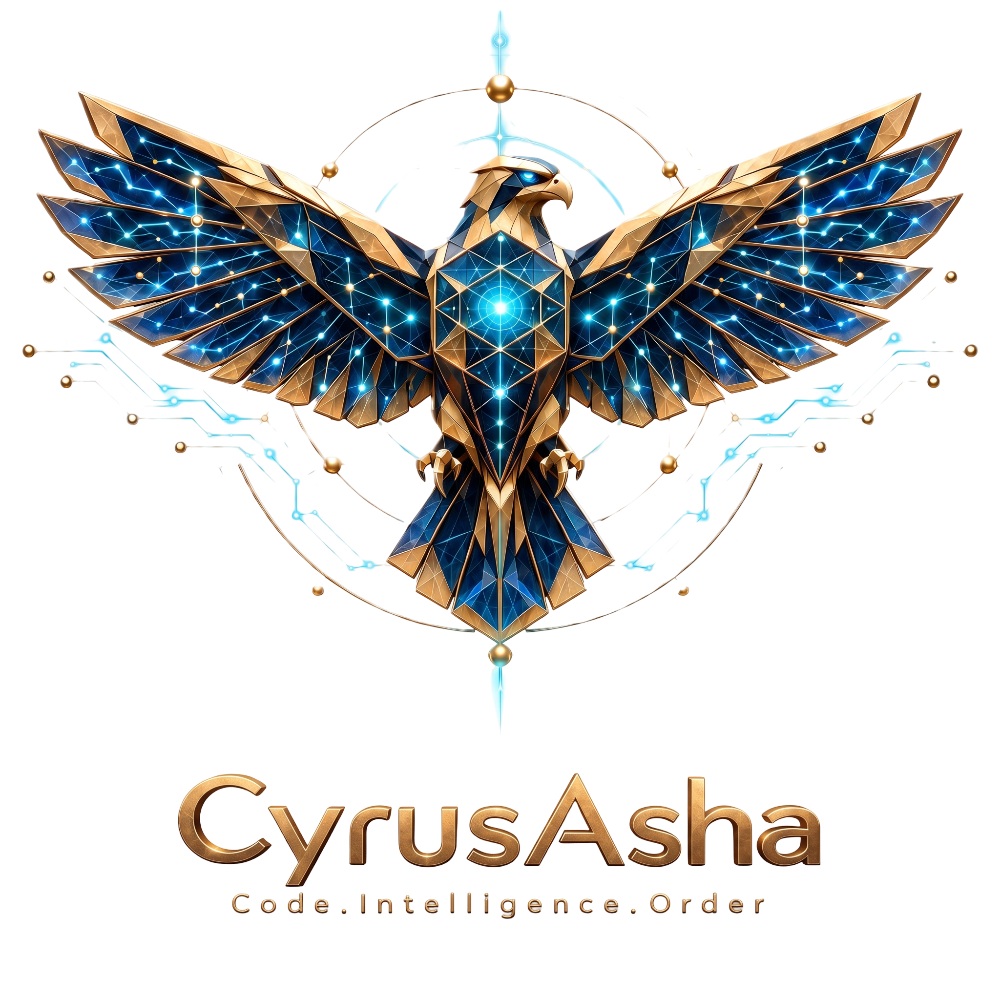
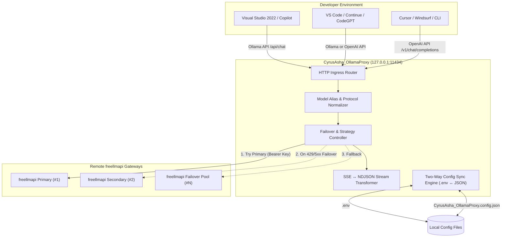
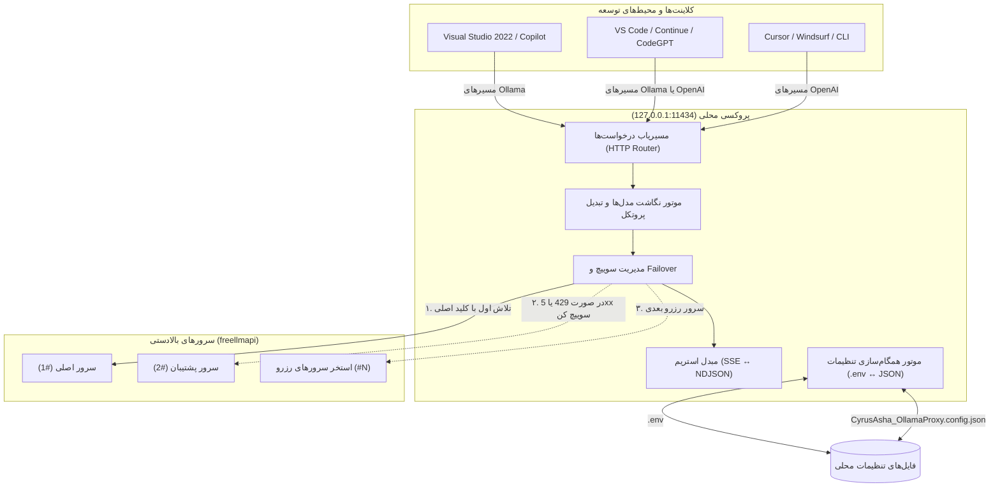

<div align="center">



# CyrusAsha_OllamaProxy

**Code. Intelligence. Order.**

A lightweight, enterprise-grade local **Ollama-** and **OpenAI-compatible** reverse proxy designed for **Visual Studio**, **GitHub Copilot**, **VS Code**, **Cursor**, and AI developer tools. It forwards requests to one or multiple `freellmapi` upstreams with automatic failover, real-time bidirectional stream translation, tool-calling pass-through, and automatic `.env` ↔ JSON configuration synchronization.

[](https://nodejs.org/)
[](https://github.com/)
[](LICENSE)
[](#-visual-studio--client-setup)
[](#upstream-modes)
[](#how-the-config-sync-works)
[](CONTRIBUTING.md)

[🇬🇧 English](#-english) &nbsp;&bull;&nbsp; [🇮🇷 فارسی](#-فارسی)

</div>

---

## 🇬🇧 English

### Table of Contents
- [Why CyrusAsha_OllamaProxy?](#why-cyrusasha_ollamaproxy)
- [Key Features](#key-features)
- [Architecture](#architecture)
- [Requirements](#requirements)
- [Installation & Quick Start](#installation--quick-start)
- [Configuration System](#configuration-system)
  - [Two-Way Config Synchronization](#how-the-config-sync-works)
  - [Settings Reference](#settings-reference)
  - [Upstream Modes](#upstream-modes)
  - [Model Aliasing](#model-aliasing)
- [Supported Endpoints](#supported-endpoints)
- [Visual Studio & Client Setup](#visual-studio--client-setup)
- [Tool Calling & Streaming](#tool-calling--streaming)
- [Testing & Verification](#testing--verification)
- [Troubleshooting & FAQ](#troubleshooting--faq)
- [Security Architecture](#security-architecture)
- [Project Structure](#project-structure)
- [Contributing & License](#contributing--license)

---

### Why CyrusAsha_OllamaProxy?

Visual Studio, GitHub Copilot, and modern developer IDEs are designed to interface seamlessly with a **local Ollama instance** (`http://127.0.0.1:11434`) or standard **OpenAI-compatible endpoints** (`/v1/*`).

In enterprise and custom developer workflows, backend LLMs are often provided by external API gateways like `freellmapi` secured with API keys, quota limits, and rate limits. 

**CyrusAsha_OllamaProxy** bridges this gap:
1. **Client Transparency:** Your IDE connects locally to `127.0.0.1:11434` exactly as if a native Ollama or OpenAI service were running.
2. **High Availability & Failover:** Configure multiple `freellmapi` endpoints and keys. If an upstream encounters rate limits (429), quota exhaustion, or server errors (5xx), the proxy transparently retries the next upstream with zero interruption to your editor.
3. **Bi-directional Configuration Mirroring:** Eliminates config drift by synchronizing `.env` and `CyrusAsha_OllamaProxy.config.json` bidirectionally on every launch while preserving comments and structure.
4. **Agentic Tool Calling Support:** Passes through function calling payloads (`tools`, `tool_calls`, `tool_choice`) intact for modern autonomous coding agents.

---

### Key Features

| Icon | Capability | Description |
|:---:|---|---|
| 🧩 | **Dual Protocol Emulation** | Fully emulates Ollama endpoints (`/api/chat`, `/api/generate`, `/api/tags`, `/api/show`, `/api/ps`) and OpenAI endpoints (`/v1/models`, `/v1/chat/completions`, `/v1/responses`). |
| ♻️ | **Intelligent Failover** | Automatic multi-upstream failover with `ordered` (priority) or `round-robin` load distribution strategies. |
| 🌊 | **Low-Latency Streaming** | Real-time on-the-fly bidirectional conversion between OpenAI Server-Sent Events (SSE) and Ollama NDJSON streams. |
| 🛠️ | **Native Tool Calling** | Full transparent pass-through of OpenAI function calling arguments and tool execution responses. |
| 🎭 | **Model Aliasing** | Maps custom exposed model names (e.g., `copilot-free:latest`) to upstream target models (e.g., `auto`, `gpt-4o`, `deepseek-chat`). |
| 🔁 | **Automated Config Sync** | Reads and synchronizes `.env` ↔ `CyrusAsha_OllamaProxy.config.json` with conflict resolution based on file modification timestamps (`mtime`). |
| 🪶 | **Minimalist Footprint** | Pure modern Node.js (ES modules). Zero compilation/build step. Only one lightweight runtime dependency (`dotenv`). |
| 🛡️ | **Enterprise Security** | Binds strictly to localhost loopback (`127.0.0.1`) by default, masks credentials in logs, and isolates Bearer tokens. |

---

### Architecture



#### Request Flow:
```text
Client (Copilot)
   │ POST http://127.0.0.1:11434/api/chat
   ▼
CyrusAsha_OllamaProxy
   │ 1. Maps 'copilot-free:latest' -> 'auto'
   │ 2. Translates Ollama payload -> OpenAI payload
   │ 3. Injects 'Authorization: Bearer <KEY>'
   ▼
Upstream #1 (http://127.0.0.1:3001/v1)
   │ ── [429 Quota Exceeded / 502 Bad Gateway] ──▶ Silent Failover
   ▼
Upstream #2 (http://127.0.0.1:3002/v1)
   │ ── [200 OK / SSE Stream] ──▶ Translated to NDJSON Stream
   ▼
Client receives real-time response chunks
```

---

### Requirements

- **Node.js 18.0.0 or higher** (relies on built-in native `fetch` and `AbortController`).
- One or more running `freellmapi` instances (or OpenAI-compatible providers) with valid API keys.
- Any IDE or client supporting Ollama or OpenAI endpoints (Visual Studio, VS Code, Cursor, Windsurf, curl, etc.).

---

### Installation & Quick Start

1. **Clone the repository:**
   ```bash
   git clone https://github.com/your-username/CyrusAsha_OllamaProxy.git
   cd CyrusAsha_OllamaProxy
   ```

2. **Install dependencies:**
   ```bash
   npm install
   ```

3. **Initialize configuration:**
   Copy the example `.env` file (or start the server once to generate it):
   ```bash
   # Windows PowerShell:
   Copy-Item .env.example .env

   # Linux / macOS:
   cp .env.example .env
   ```

4. **Configure your upstream:**
   Open `.env` (or `CyrusAsha_OllamaProxy.config.json`) and insert your upstream URL and API key:
   ```env
   FREELLMAPI_BASE_URL=http://127.0.0.1:3001/v1
   FREELLMAPI_API_KEY=freellmapi-your-actual-api-key
   ```

5. **Start the proxy:**
   ```bash
   npm start
   ```

#### Sample Startup Console Output:
```text
🔧 CyrusAsha_OllamaProxy config: .env ↔ CyrusAsha_OllamaProxy.config.json (env)
💾 Config files updated: CyrusAsha_OllamaProxy.config.json
🦅 CyrusAsha_OllamaProxy listening on http://127.0.0.1:11434 (Ollama + OpenAI compatible)
🤖 Upstream default model: auto
📋 Exposed models: copilot-free:latest
🧭 Model mappings: copilot-free:latest -> auto
🔁 Upstream strategy: ordered
🌐 Upstreams: upstream-1=http://127.0.0.1:3001/v1 key=****f2e4 (len=58)
```
> **Security Note:** Keys are never printed in plaintext; only the length and the trailing 4 characters are shown for verification.

---

### Configuration System

`CyrusAsha_OllamaProxy` features a unique **dual-format configuration synchronization layer**.

| File | Format | Version Control | Description |
|---|---|:---:|---|
| `.env` | KEY=value | ❌ Ignored | Standard dotenv format. Preserves comments and structure. |
| `CyrusAsha_OllamaProxy.config.json` | JSON | ❌ Ignored | Structured JSON format. Synchronized twin of `.env`. |
| `.env.example` | KEY=value | ✅ Tracked | Template for dotenv setup with safe placeholder values. |
| `CyrusAsha_OllamaProxy.config.example.json` | JSON | ✅ Tracked | Template for JSON setup with safe placeholder values. |
| `.config-sync.json` | JSON | ❌ Ignored | Internal sync state file tracking synced keys and timestamps. |

#### How the Config Sync Works

On every execution, both configuration files are inspected and merged:
- **Missing Keys:** If a key exists in `.env` but not in the JSON file (or vice versa), it is automatically populated into the other file.
- **Value Updates:** If a value is modified in one file, the newest value is propagated to the other.
- **Conflict Resolution:** If a key was modified in **both** files with differing values, the file with the most recent filesystem modification timestamp (`mtime`) wins, and a descriptive warning is logged.
- **Deletions:** If a key is intentionally deleted from one file, the sync layer removes it from the twin file.
- **Shell Overrides:** Any environment variable set in your current shell session (`process.env`) takes absolute precedence over both files without altering disk contents.
- **Disable Sync:** Launching with `CONFIG_SYNC=off` disables disk writes and operates in read-only mode.

#### Settings Reference

| Environment Variable | Default Value | Description |
|---|---|---|
| `PORT` | `11434` | Local listening port (11434 is Ollama's default expected by Copilot). |
| `HOST` | `127.0.0.1` | Bind address. Kept on loopback (`127.0.0.1`) for local security. |
| `FREELLMAPI_BASE_URL` | `http://127.0.0.1:3001/v1` | Primary upstream endpoint URL for single-upstream mode. |
| `FREELLMAPI_API_KEY` | *(Required)* | API key for the primary upstream endpoint. |
| `FREELLMAPI_BASE_URLS` | *(Optional)* | Comma-separated list of upstream URLs for multi-upstream mode. |
| `FREELLMAPI_API_KEYS` | *(Optional)* | Comma-separated list of API keys paired by index with `FREELLMAPI_BASE_URLS`. |
| `FREELLMAPI_UPSTREAMS_JSON` | *(Optional)* | Full JSON array of `{name, baseURL, apiKey}` objects. Takes highest priority. |
| `UPSTREAM_STRATEGY` | `ordered` | Strategy for routing requests: `ordered` (priority list) or `round-robin` (load distribution). |
| `RETRY_STATUS_CODES` | `401,403,404,408,409,429,500,502,503,504` | HTTP response codes that trigger failover to the next upstream. |
| `DEFAULT_MODEL` | `auto` | Fallback model identifier sent to upstream providers. |
| `OLLAMA_MODELS` | `copilot-free=auto` | Model aliases formatted as `visible-name=upstream-model`, comma-separated. |
| `ADD_LATEST_TAG` | `true` | Automatically appends `:latest` tag to exposed Ollama model names. |
| `REQUEST_TIMEOUT_MS` | `120000` | Upstream request timeout in milliseconds (120 seconds default). |

#### Shell-Specific Control Variables
- `CONFIG_SYNC=off`: Read settings into memory without writing changes back to disk.
  - PowerShell: `$env:CONFIG_SYNC="off"; npm start`
  - Linux/macOS: `CONFIG_SYNC=off npm start`
  - Windows CMD: `set CONFIG_SYNC=off && npm start`
- `CYRUSASHA_CONFIG_DIR=<path>`: Custom directory for reading/writing configuration files instead of the project root.

---

### Upstream Modes

You can configure upstreams in one of three ways:

#### Mode 1: Single Upstream (Classic)
```env
FREELLMAPI_BASE_URL=http://127.0.0.1:3001/v1
FREELLMAPI_API_KEY=freellmapi-key-1
```

#### Mode 2: Multi-Upstream CSV (Automatic Index Pairing)
```env
FREELLMAPI_BASE_URLS=http://127.0.0.1:3001/v1,http://127.0.0.1:3002/v1
FREELLMAPI_API_KEYS=freellmapi-key-1,freellmapi-key-2
```
*Note:* If multiple keys are provided with a single URL, the URL is reused across all keys. If multiple URLs are provided with one key, that key is reused across all URLs.

#### Mode 3: Structured JSON (Highest Priority)
In `.env` (stored on a single line):
```env
FREELLMAPI_UPSTREAMS_JSON=[{"name":"upstream-primary","baseURL":"http://127.0.0.1:3001/v1","apiKey":"key-1"},{"name":"upstream-backup","baseURL":"http://127.0.0.1:3002/v1","apiKey":"key-2"}]
```
In `CyrusAsha_OllamaProxy.config.json` (stored as formatted, editable JSON):
```json
{
  "FREELLMAPI_UPSTREAMS_JSON": [
    {
      "name": "upstream-primary",
      "baseURL": "http://127.0.0.1:3001/v1",
      "apiKey": "key-1"
    },
    {
      "name": "upstream-backup",
      "baseURL": "http://127.0.0.1:3002/v1",
      "apiKey": "key-2"
    }
  ]
}
```

---

### Model Aliasing

Certain tools (such as GitHub Copilot or specific IDE extensions) exhibit unexpected behavior or errors if they encounter a raw model identifier named `auto`. 

`CyrusAsha_OllamaProxy` resolves this with alias translation:
```env
OLLAMA_MODELS=copilot-free=auto
```
- **What your client sees:** `copilot-free:latest`
- **What freellmapi receives:** `auto`

#### Multiple Aliases Example:
```env
OLLAMA_MODELS=copilot-free=auto,claude-local=claude-3-5-sonnet,deepseek=deepseek-coder
```
When a client requests `GET /api/tags`, the proxy lists:
- `copilot-free:latest`
- `claude-local:latest`
- `deepseek:latest`

Each request is automatically routed to its respective upstream model name.

---

### Supported Endpoints

#### Ollama-Compatible Endpoints
| HTTP Method | Route | Description |
|:---:|---|---|
| `GET` | `/` | Health check (`Ollama is running`). |
| `GET` | `/api/version` | Returns simulated Ollama engine version (`0.5.0`). |
| `GET` / `POST` | `/api/tags` | Enumerates available models with simulated digests and parameters. |
| `GET` | `/api/ps` | Returns running model processes (returns empty list for compatibility). |
| `POST` | `/api/show` | Returns model architecture details, context window (128k), and tool capabilities. |
| `POST` | `/api/chat` | Chat completions supporting non-streaming and NDJSON streaming. |
| `POST` | `/api/generate` | Text generation completions supporting non-streaming and NDJSON streaming. |

#### OpenAI-Compatible Endpoints
| HTTP Method | Route | Description |
|:---:|---|---|
| `GET` | `/v1/models`, `/models` | Standard OpenAI model list object. |
| `POST` | `/v1/chat/completions`, `/chat/completions` | Standard chat completions with OpenAI SSE stream pass-through. |
| `POST` | `/api/chat/completions`, `/api/v1/chat/completions` | Alternate path aliases for various client libraries. |
| `POST` | `/v1/responses`, `/responses` | OpenAI Responses API endpoint emulation. |

---

### Visual Studio & Client Setup

#### 1. Visual Studio 2022 (GitHub Copilot Local Model)
- Navigate to: **Tools** &rarr; **Options** &rarr; **GitHub** &rarr; **Copilot** (or local model providers).
- Set Endpoint URL: `http://127.0.0.1:11434`
- Set Model: `copilot-free:latest` (or your configured alias).

#### 2. VS Code (Continue Extension / CodeGPT)
In your `~/.continue/config.json`:
```json
{
  "models": [
    {
      "title": "CyrusAsha Proxy",
      "provider": "ollama",
      "model": "copilot-free:latest",
      "apiBase": "http://127.0.0.1:11434"
    }
  ]
}
```

#### 3. Cursor / Windsurf / Custom OpenAI Provider
- **Base URL:** `http://127.0.0.1:11434/v1`
- **API Key:** `local` (or any dummy non-empty string)
- **Model Name:** `copilot-free:latest`

---

### Tool Calling & Streaming

#### Real-time Streaming Conversion
- **OpenAI Upstream to Ollama Client:** The upstream produces an OpenAI Server-Sent Event stream (`text/event-stream`). The proxy parses each `data: {...}` chunk and converts it into Ollama NDJSON lines (`application/x-ndjson`), concluding with a `done: true` metadata frame.
- **OpenAI Upstream to OpenAI Client:** The SSE stream passes through untouched with low latency and zero memory accumulation.

#### Tool Calling (Function Calling)
Modern agentic workflows require structured tool invocations. `CyrusAsha_OllamaProxy` preserves:
- Inbound parameters: `tools`, `tool_choice`
- Outbound responses: `tool_calls`, `tool_call_id`, `function`
- Assistant messages with `tool_calls` and `null` content are handled transparently.

---

### Testing & Verification

#### 1. Test Ollama Model Listing:
```bash
curl http://127.0.0.1:11434/api/tags
```
*PowerShell:*
```powershell
Invoke-RestMethod http://127.0.0.1:11434/api/tags | ConvertTo-Json -Depth 5
```

#### 2. Test Ollama Chat (Non-Streaming):
```bash
curl -X POST http://127.0.0.1:11434/api/chat \
  -H "Content-Type: application/json" \
  -d '{
    "model": "copilot-free:latest",
    "stream": false,
    "messages": [{"role": "user", "content": "Explain binary search in one sentence."}]
  }'
```

#### 3. Test OpenAI Route (`/v1/chat/completions`):
```bash
curl -X POST http://127.0.0.1:11434/v1/chat/completions \
  -H "Content-Type: application/json" \
  -d '{
    "model": "copilot-free:latest",
    "messages": [{"role": "user", "content": "Hello!"}]
  }'
```

#### 4. Python SDK Example:
```python
from openai import OpenAI

client = OpenAI(
    base_url="http://127.0.0.1:11434/v1",
    api_key="local"
)

response = client.chat.completions.create(
    model="copilot-free:latest",
    messages=[{"role": "user", "content": "Hello via Python SDK!"}]
)
print(response.choices[0].message.content)
```

---

### Troubleshooting & FAQ

| Problem | Root Cause | Solution |
|---|---|---|
| `EADDRINUSE: address already in use` | Another process is already occupying port 11434 (e.g., standard Ollama or a zombie Node process). | Find and terminate the process: <br/>• Windows: `netstat -ano \| findstr :11434` followed by `taskkill /PID <PID> /F`<br/>• Linux/macOS: `lsof -i :11434` followed by `kill -9 <PID>` |
| Server boots on an unexpected port | An exported environment variable `PORT` exists in your shell, which overrides config files. | Start explicitly with `PORT=11434 npm start` or unset `PORT` in your shell profile. |
| `All upstreams failed` error | No upstream answered successfully or all returned retryable HTTP codes. | 1. Check your upstream server status (`freellmapi`).<br/>2. Verify your API key and URL in `.env`.<br/>3. Verify network/firewall connectivity to upstream. |
| Configuration edit reverted | You edited one config file while the twin file had a newer disk timestamp. | The file with the newest timestamp wins during sync. Ensure your editor saves files properly or run with `CONFIG_SYNC=off` if you prefer manual management. |
| Model not recognized by Copilot | Model name mismatch between IDE configuration and `OLLAMA_MODELS`. | Verify what `curl http://127.0.0.1:11434/api/tags` outputs and set your IDE to pick that exact model name. |

---

### Security Architecture

- **Strict Localhost Binding:** The proxy binds exclusively to `127.0.0.1` by default. It is not exposed to external LAN/WAN interfaces unless `HOST` is deliberately modified.
- **Credential Protection:** Secrets (`.env`, `CyrusAsha_OllamaProxy.config.json`, `.config-sync.json`) are strictly ignored in `.gitignore`.
- **Log Masking:** Logs redact API keys, printing only the trailing 4 characters and string length (`****abcd`).
- **Token Isolation:** API keys are injected solely into the outbound HTTP `Authorization` header targeted at configured upstreams.
- Read our [SECURITY.md](SECURITY.md) and [THREAT-MODEL.md](THREAT-MODEL.md) for detailed policies.

---

### Project Structure

```text
CyrusAsha_OllamaProxy/
├── src/
│   ├── CyrusAsha_OllamaProxy.js          # Core HTTP server, routing, streaming & failover logic
│   └── config.js                         # Two-way .env ↔ JSON synchronization & config loader
├── assets/
│   └── CyrusAsha-logo-withoutBG.png      # Official project logo & social preview
├── .env.example                          # Template for environment configuration
├── CyrusAsha_OllamaProxy.config.example.json # Template for JSON configuration
├── .gitignore                            # Git exclusion rules (safeguarding secrets & caches)
├── package.json                          # Project manifest & metadata
├── LICENSE                               # MIT License
├── README.md                             # Comprehensive bilingual documentation
├── SECURITY.md                           # Vulnerability disclosure & security policy
├── THREAT-MODEL.md                       # STRIDE threat model & boundary analysis
├── SECURITY-CHECKLIST.md                 # Pre-release security verification checklist
└── CONTRIBUTING.md                       # Contribution guidelines & development workflow
```

---

### Contributing & License

Contributions, bug reports, and suggestions are welcome! Please check [CONTRIBUTING.md](CONTRIBUTING.md) before opening a pull request.

This project is licensed under the **MIT License**. See the [LICENSE](LICENSE) file for details.

**Built with pride by CyrusAsha** — *Code. Intelligence. Order.*

---

<div dir="rtl">

## 🇮🇷 فارسی

### فهرست مطالب
- [چرا این پروژه؟ (مسئله و راه‌حل)](#چرا-این-پروژه-مسئله-و-راه‌حل)
- [امکانات کلیدی](#امکانات-کلیدی)
- [معماری سیستم](#معماری-سیستم)
- [پیش‌نیازها](#پیش‌نیازها)
- [نصب و اجرای سریع](#نصب-و-اجرای-سریع)
- [سیستم تنظیمات](#سیستم-تنظیمات)
  - [همگام‌سازی دوطرفه (.env و JSON)](#همگام‌سازی-دوطرفه-چطور-کار-می‌کند)
  - [جدول مرجع متغیرها](#جدول-مرجع-تنظیمات)
  - [حالت‌های تعریف Upstream](#حالت‌های-تعریف-upstream)
  - [نگاشت و نام مستعار مدل‌ها (Model Aliasing)](#نام-مستعار-مدل‌ها-model-aliasing)
- [مسیرهای پشتیبانی‌شده (Endpoints)](#مسیرهای-پشتیبانی‌شده-endpoints)
- [راهنمای اتصال به Visual Studio و ابزارها](#راهنمای-اتصال-به-visual-studio-و-ابزارها)
- [استریم زنده و فراخوانی ابزارها (Tool Calling)](#استریم-زنده-و-فراخوانی-ابزارها-tool-calling)
- [آزمون و ارزیابی](#آزمون-و-ارزیابی)
- [رفع اشکال و سوالات متداول](#رفع-اشکال-و-سوالات-متداول)
- [معماری امنیت](#معماری-امنیت)
- [ساختار فایل‌های پروژه](#ساختار-فایل‌های-پروژه)
- [مشارکت و لایسنس](#مشارکت-و-لایسنس)

---

### چرا این پروژه؟ (مسئله و راه‌حل)

محیط‌های توسعه مدرن از جمله **Visual Studio 2022**، **GitHub Copilot**، **VS Code**، **Cursor** و افزونه‌هایی مانند Continue برای اجرای مدل‌های هوش مصنوعی به‌گونه‌ای طراحی شده‌اند که با یک سرور محلی **Ollama** روی پورت `11434` یا اندپوینت‌های سازگار با **OpenAI** ارتباط برقرار کنند.

در دنیای واقعی و پروژه‌های تیمی، دسترسی به مدل‌های قدرتمند اغلب از طریق درگاه‌های واسط مانند `freellmapi` با کلیدهای API، محدودیت تعداد درخواست (Rate Limits) و سقف مصرف (Quota) فراهم می‌شود.

**پروژه CyrusAsha_OllamaProxy دقیقاً این پل ارتباطی را می‌سازد:**
۱. **شفافیت کامل برای ادیتور:** ابزارهای برنامه‌نویسی شما دقیقاً فکر می‌کنند با یک سرور استاندارد Ollama یا OpenAI محلی صحبت می‌کنند.
۲. **پایداری بالا با Failover خودکار:** چندین آدرس و کلید API تعریف کنید؛ اگر یک سرور به خطای سهمیه (429) یا خطای داخلی (5xx) برخورد، درخواست بلافاصله و بدون متوقف شدن کار شما به سرور بعدی منتقل می‌شود.
۳. **همگام‌سازی دوطرفه تنظیمات:** با موتور انحصاری همگام‌سازی، فایل `.env` و `CyrusAsha_OllamaProxy.config.json` همیشه با حفظ کامنت‌ها و اولویت آخرین تغییرات معادل هم نگه داشته می‌شوند.
۴. **پشتیبانی از Tool Calling:** ابزارهای خودکار و Agent Mode بدون هیچ مشکلی می‌توانند دستورات Function Calling خود را ارسال و دریافت کنند.

---

### امکانات کلیدی

| آیکون | قابلیت | توضیح |
|:---:|---|---|
| 🧩 | **پشتیبانی دوگانه Ollama و OpenAI** | شبیه‌سازی کامل مسیرهای Ollama (مانند `/api/chat`, `/api/generate`, `/api/tags`, `/api/show`) و OpenAI (مانند `/v1/chat/completions`, `/v1/models`, `/v1/responses`). |
| ♻️ | **Failover و توزیع بار هوشمند** | قابلیت جابه‌جایی خودکار در زمان بروز خطا بر اساس دو استراتژی اولویتی (`ordered`) یا چرخشی (`round-robin`). |
| 🌊 | **استریم سریع و تبدیل فرمت برخط** | تبدیل لحظه‌ای و دوطرفه بین جریان‌های SSE اوپن‌ای‌آی و NDJSON اولاما بدون افت سرعت و بدون نگه‌داشتن داده در حافظه. |
| 🛠️ | **پشتیبانی از Tool Calling** | عبور کامل و دست‌نخورده فیلدهای فراخوانی ابزارها (`tools`, `tool_calls`, `tool_choice`) برای محیط‌های Agentic. |
| 🎭 | **سیستم Model Aliasing** | تغییر نام مدل‌های نمایشی کلاینت (مثل `copilot-free:latest`) به مدل هدف سرور اصلی (مثل `auto`, `deepseek-chat`). |
| 🔁 | **موتور همگام‌سازی دوطرفه** | ادغام هوشمند فایل‌های `.env` و JSON بر پایه آخرین زمان تغییر فایل (`mtime`) و حل تعارضات. |
| 🪶 | **سبک و بدون نیاز به Build** | کد خالص مدرن جاوااسکریپت (Node.js ES Modules) با تنها یک وابستگی (`dotenv`) و سرعت اجرای آنی. |
| 🛡️ | **امنیت بومی و پایش محلی** | محدود به Loopback محلی (`127.0.0.1`)، ماسک کردن خودکار کلیدها در لاگ و حفاظت از اطلاعات حساس. |

---

### معماری سیستم



#### جریان یک درخواست نمونه:
```text
کلاینت (Copilot)
   │ ارسال درخواست به http://127.0.0.1:11434/api/chat
   ▼
CyrusAsha_OllamaProxy
   │ ۱. ترجمه نام مدل 'copilot-free:latest' به 'auto'
   │ ۲. تبدیل ساختار پیام‌ها از اولاما به اوپن‌ای‌آی
   │ ۳. افزودن هدر 'Authorization: Bearer <KEY>'
   ▼
سرور بالادستی ۱ (http://127.0.0.1:3001/v1)
   │ ── [پاسخ خطای 429 یا خطای شبکه] ──▶ سوییچ بی‌صدا به سرور بعدی
   ▼
سرور بالادستی ۲ (http://127.0.0.1:3002/v1)
   │ ── [پاسخ 200 OK و استریم داده] ──▶ تبدیل زنده SSE به NDJSON
   ▼
کلاینت پاسخ را به صورت لحظه‌ای و کلمه به کلمه دریافت می‌کند
```

---

### پیش‌نیازها

- **Node.js نسخه ۱۸.۰.۰ یا بالاتر** (به دلیل استفاده از `fetch` بومی و `AbortController`).
- یک یا چند آدرس سرور `freellmapi` (یا ارائه‌دهنده سازگار با OpenAI) به همراه API Key معتبر.
- نرم‌افزارهای مقصد مانند Visual Studio 2022، VS Code، Cursor، Windsurf یا دستورات ترمینال.

---

### نصب و اجرای سریع

۱. **کلون کردن مخزن پروژه:**
   ```bash
   git clone https://github.com/your-username/CyrusAsha_OllamaProxy.git
   cd CyrusAsha_OllamaProxy
   ```

۲. **نصب وابستگی‌ها:**
   ```bash
   npm install
   ```

۳. **آماده‌سازی فایل تنظیمات:**
   فایل نمونه `.env.example` را به عنوان `.env` کپی کنید:
   ```powershell
   # در ویندوز پاورشل:
   Copy-Item .env.example .env

   # در لینوکس / مک:
   cp .env.example .env
   ```

۴. **تنظیم آدرس سرور و کلید API:**
   فایل `.env` یا `CyrusAsha_OllamaProxy.config.json` را باز کرده و اطلاعات سرور خود را بگذارید:
   ```env
   FREELLMAPI_BASE_URL=http://127.0.0.1:3001/v1
   FREELLMAPI_API_KEY=freellmapi-your-actual-api-key
   ```

۵. **اجرای سرور:**
   ```bash
   npm start
   ```

#### خروجی نمونه کنسول در هنگام اجرا:
```text
🔧 CyrusAsha_OllamaProxy config: .env ↔ CyrusAsha_OllamaProxy.config.json (env)
💾 Config files updated: CyrusAsha_OllamaProxy.config.json
🦅 CyrusAsha_OllamaProxy listening on http://127.0.0.1:11434 (Ollama + OpenAI compatible)
🤖 Upstream default model: auto
📋 Exposed models: copilot-free:latest
🧭 Model mappings: copilot-free:latest -> auto
🔁 Upstream strategy: ordered
🌐 Upstreams: upstream-1=http://127.0.0.1:3001/v1 key=****f2e4 (len=58)
```
> **نکته امنیتی:** برای امنیت بیشتر، کلیدهای API به صورت کامل در لاگ نمایش داده نمی‌شوند و فقط ۴ رقم پایانی به همراه طول کلید چاپ می‌شود.

---

### سیستم تنظیمات

پروژه دارای یک **لایه همگام‌سازی دوگانه** میان فرمت کلاسیک `.env` و فرمت ساخت‌یافته JSON است:

| فایل | فرمت | وضعیت در Git | توضیح |
|---|---|:---:|---|
| `.env` | KEY=value | ❌ نادیده گرفته می‌شود | فرمت سنتی dotenv با حفظ کامل کامنت‌ها و ساختار خطوط. |
| `CyrusAsha_OllamaProxy.config.json` | JSON | ❌ نادیده گرفته می‌شود | فایل دوقلوی ساخت‌یافته که آینه کامل `.env` است. |
| `.env.example` | KEY=value | ✅ در مخزن گیت | فایل الگو با مقادیر امن جهت راهنمایی کاربر. |
| `CyrusAsha_OllamaProxy.config.example.json` | JSON | ✅ در مخزن گیت | فایل الگوی JSON با مقادیر امن جهت راهنمایی کاربر. |
| `.config-sync.json` | JSON | ❌ نادیده گرفته می‌شود | فایل مدیریت وضعیت داخلی برای تشخیص دقیق تغییرات کلیدها. |

#### همگام‌سازی دوطرفه چطور کار می‌کند

در هر بار اجرای برنامه، هر دو فایل خوانده و ادغام می‌شوند:
- **کلیدهای جدید:** اگر کلیدی فقط در یکی از دو فایل باشد، به طور خودکار به فایل دیگر اضافه می‌گردد.
- **تغییر مقدار:** اگر مقداری در یک فایل به‌روز شود، روی فایل دیگر نیز اعمال خواهد شد.
- **حل تعارضات (Conflict Resolution):** اگر یک متغیر همزمان در هر دو فایل با مقدارهای متفاوت تغییر داده شده باشد، فایلی که زمان ذخیره‌سازی (`mtime`) جدیدتری روی دیسک دارد برنده شده و یک هشدار لاگ می‌شود.
- **حذف متغیر:** اگر متغیری را عمداً از یک فایل حذف کنید، از فایل دیگر نیز پاک خواهد شد.
- **اولویت متغیرهای شل:** متغیرهایی که در خط فرمان ست شده باشند بر هر دو فایل اولویت دارند بدون آنکه محتوای دیسک را خراب کنند.
- **حالت فقط خواندنی:** با تنظیم `CONFIG_SYNC=off` می‌توانید عملیات نوشتن روی دیسک را غیرفعال کنید.

#### جدول مرجع تنظیمات

| نام متغیر | مقدار پیش‌فرض | توضیح |
|---|---|---|
| `PORT` | `11434` | پورت محلی سرور پروکسی (پورت پیش‌فرض و استاندارد اولاما). |
| `HOST` | `127.0.0.1` | آدرس لوکال جهت جلوگیری از دسترسی سیستم‌های متفرقه از شبکه. |
| `FREELLMAPI_BASE_URL` | `http://127.0.0.1:3001/v1` | آدرس سرور اصلی برای حالت تک‌سرور. |
| `FREELLMAPI_API_KEY` | *(الزامی)* | کلید دسترسی به سرور اصلی بالادست. |
| `FREELLMAPI_BASE_URLS` | *(اختیاری)* | لیست آدرس‌های چند سرور به صورت جداشده با کاما (حالت چندسرور). |
| `FREELLMAPI_API_KEYS` | *(اختیاری)* | لیست کلیدهای API متناظر با آدرس‌ها بر پایه شماره ایندکس. |
| `FREELLMAPI_UPSTREAMS_JSON` | *(اختیاری)* | آرایه کامل JSON شامل مشخصات نام، آدرس و کلید سرورها (بالاترین اولویت). |
| `UPSTREAM_STRATEGY` | `ordered` | استراتژی مسیریابی: `ordered` (شروع از اولویت اول) یا `round-robin` (توزیع بار نوبتی). |
| `RETRY_STATUS_CODES` | `401,403,404,408,409,429,500,502,503,504` | کدهای خطایی که در صورت دریافت از سرور، باعث سوییچ به سرور بعدی می‌شوند. |
| `DEFAULT_MODEL` | `auto` | نام پیش‌فرض مدل ارسالی به سرور بالادست. |
| `OLLAMA_MODELS` | `copilot-free=auto` | نگاشت نام مدل‌ها به فرمت `نام-نمایشی=مدل-سرور` جدا شده با کاما. |
| `ADD_LATEST_TAG` | `true` | افزودن خودکار پسوند `:latest` به نام مدل‌ها در اولاما. |
| `REQUEST_TIMEOUT_MS` | `120000` | مهلت زمانی درخواست به سرور (پیش‌فرض ۱۲۰ ثانیه). |

#### متغیرهای اختصاصی خط فرمان
- `CONFIG_SYNC=off`: غیرفعال کردن نوشتن روی فایل‌ها در اجرای برنامه.
  - ویندوز پاورشل: `$env:CONFIG_SYNC="off"; npm start`
  - لینوکس / مک: `CONFIG_SYNC=off npm start`
  - ویندوز CMD: `set CONFIG_SYNC=off && npm start`
- `CYRUSASHA_CONFIG_DIR=<path>`: مشخص کردن مسیری خارج از ریشه پروژه برای فایل‌های پیکربندی.

---

### حالت‌های تعریف Upstream

#### حالت ۱: تک‌سرور (کلاسیک)
```env
FREELLMAPI_BASE_URL=http://127.0.0.1:3001/v1
FREELLMAPI_API_KEY=freellmapi-key-1
```

#### حالت ۲: چندسرور با فرمت CSV
```env
FREELLMAPI_BASE_URLS=http://127.0.0.1:3001/v1,http://127.0.0.1:3002/v1
FREELLMAPI_API_KEYS=freellmapi-key-1,freellmapi-key-2
```
*نکته:* جفت‌سازی بر اساس ردیف است. اگر یک آدرس و چند کلید بنویسید، آن آدرس با تمام کلیدها استفاده می‌شود و برعکس.

#### حالت ۳: آرایه ساخت‌یافته JSON (بالاترین اولویت)
در فایل `.env` (در یک خط):
```env
FREELLMAPI_UPSTREAMS_JSON=[{"name":"main","baseURL":"http://127.0.0.1:3001/v1","apiKey":"key-1"},{"name":"backup","baseURL":"http://127.0.0.1:3002/v1","apiKey":"key-2"}]
```
در فایل `CyrusAsha_OllamaProxy.config.json` (خوانا و مرتب):
```json
{
  "FREELLMAPI_UPSTREAMS_JSON": [
    {
      "name": "main",
      "baseURL": "http://127.0.0.1:3001/v1",
      "apiKey": "key-1"
    },
    {
      "name": "backup",
      "baseURL": "http://127.0.0.1:3002/v1",
      "apiKey": "key-2"
    }
  ]
}
```

---

### نام مستعار مدل‌ها (Model Aliasing)

برخی کلاینت‌ها (مانند GitHub Copilot) اگر نام مدل را به شکل خام `auto` دریافت کنند، دچار رفتار نامناسب یا خطای عدم شناسایی مدل می‌شوند. 

این پروکسی با ویژگی نگاشت مدل این مسئله را رفع می‌کند:
```env
OLLAMA_MODELS=copilot-free=auto
```
- **آنچه کلاینت در منو می‌بیند:** `copilot-free:latest`
- **آنچه به سرور فرستاده می‌شود:** `auto`

#### تعریف چند مدل همزمان:
```env
OLLAMA_MODELS=copilot-free=auto,claude-local=claude-3-5-sonnet,deepseek=deepseek-coder
```
با درخواست کلاینت به `/api/tags`، تمامی این مدل‌ها لیست شده و درخواست هر مدل خودکار به مدل واقعی سرور بالادست متصل می‌شود.

---

### مسیرهای پشتیبانی‌شده (Endpoints)

#### مسیرهای سازگار با Ollama
| متد | مسیر | کاربرد |
|:---:|---|---|
| `GET` | `/` | بررسی زنده بودن سرور (`Ollama is running`). |
| `GET` | `/api/version` | گزارش نسخه اولاما (`0.5.0`). |
| `GET` / `POST` | `/api/tags` | لیست مدل‌های فعال همراه با پارامترها و مشخصات شبیه‌سازی‌شده. |
| `GET` | `/api/ps` | گزارش پردازش مدل‌ها (جهت سازگاری آرایه خالی برمی‌گرداند). |
| `POST` | `/api/show` | نمایش مشخصات فنی، طول کانتکست (۱۲۸ هزار توکن) و پشتیبانی از ابزارها. |
| `POST` | `/api/chat` | مسیر گفتگوی متنی با پشتیبانی از خروجی معمولی و استریم NDJSON. |
| `POST` | `/api/generate` | مسیر تکمیل متن با پشتیبانی از خروجی معمولی و استریم NDJSON. |

#### مسیرهای سازگار با OpenAI
| متد | مسیر | کاربرد |
|:---:|---|---|
| `GET` | `/v1/models`، `/models` | فهرست استاندارد مدل‌های سازگار با OpenAI. |
| `POST` | `/v1/chat/completions`، `/chat/completions` | گفتگوی استاندارد چت با پشتیبانی از استریم SSE. |
| `POST` | `/api/chat/completions`، `/api/v1/chat/completions` | مسیرهای جایگزین برای کلاینت‌های گوناگون. |
| `POST` | `/v1/responses`، `/responses` | شبیه‌سازی مسیرهای OpenAI Responses API. |

---

### راهنمای اتصال به Visual Studio و ابزارها

#### ۱. اتصال در Visual Studio 2022 (مدل لوکال GitHub Copilot)
- از منوی بالا به مسیر بروید: **Tools** &larr; **Options** &larr; **GitHub** &larr; **Copilot** (یا بخش Models).
- آدرس سرور (Endpoint): `http://127.0.0.1:11434`
- نام مدل: `copilot-free:latest` (یا نام مستعاری که تعریف کرده‌اید).

#### ۲. اتصال در VS Code (افزونه Continue یا CodeGPT)
در فایل تنظیمات `~/.continue/config.json`:
```json
{
  "models": [
    {
      "title": "CyrusAsha Proxy",
      "provider": "ollama",
      "model": "copilot-free:latest",
      "apiBase": "http://127.0.0.1:11434"
    }
  ]
}
```

#### ۳. اتصال در Cursor / Windsurf / Freebuff (پروایدر سفارشی OpenAI)
- **Base URL:** `http://127.0.0.1:11434/v1`
- **API Key:** عبارت `local` (یا هر رشته غیرخالی)
- **Model Name:** `copilot-free:latest`

---

### استریم زنده و فراخوانی ابزارها (Tool Calling)

#### تبدیل زنده جریان داده (Streaming)
- **تبدیل خروجی اوپن‌ای‌آی به اولاما:** سرور بالادست خروجی را با فرمت SSE تولید می‌کند (`text/event-stream`). پروکسی هر بسته را لحظه‌ای خوانده، به ساختار استاندارد NDJSON اولاما تبدیل کرده و با تگ پایانی `done: true` به کلاینت تحویل می‌دهد.
- **جریان اوپن‌ای‌آی به اوپن‌ای‌آی:** بسته‌ها بدون ایجاد بافر و با بالاترین سرعت مستقیماً عبور داده می‌شوند.

#### پشتیبانی کامل از Tool Calling
در کدهای خودکار و حالت Agent Mode، مدل نیاز دارد ابزارهای محیطی را صدا بزند. این پروکسی:
- آرگومان‌های `tools` و `tool_choice` ورودی را حفظ می‌کند.
- خروجی‌های `tool_calls`، شناسه‌های تابع و `tool_call_id` را به‌طور دقیق پاس می‌دهد.
- حتی پیام‌های دستیار با محتوای خالی (`null`) که فقط شامل فراخوانی ابزار هستند به درستی مدیریت می‌شوند.

---

### آزمون و ارزیابی

#### ۱. تست دریافت فهرست مدل‌ها:
```bash
curl http://127.0.0.1:11434/api/tags
```
*در پاورشل ویندوز:*
```powershell
Invoke-RestMethod http://127.0.0.1:11434/api/tags | ConvertTo-Json -Depth 5
```

#### ۲. تست چت در مسیر اولاما (بدون استریم):
```bash
curl -X POST http://127.0.0.1:11434/api/chat \
  -H "Content-Type: application/json" \
  -d '{
    "model": "copilot-free:latest",
    "stream": false,
    "messages": [{"role": "user", "content": "یک جمله درباره هوش مصنوعی بگو."}]
  }'
```

#### ۳. تست مسیر سازگار با OpenAI:
```bash
curl -X POST http://127.0.0.1:11434/v1/chat/completions \
  -H "Content-Type: application/json" \
  -d '{
    "model": "copilot-free:latest",
    "messages": [{"role": "user", "content": "سلام!"}]
  }'
```

#### ۴. تست با کتابخانه رسمی OpenAI در پایتون:
```python
from openai import OpenAI

client = OpenAI(
    base_url="http://127.0.0.1:11434/v1",
    api_key="local"
)

response = client.chat.completions.create(
    model="copilot-free:latest",
    messages=[{"role": "user", "content": "سلام از پایتون!"}]
)
print(response.choices[0].message.content)
```

---

### رفع اشکال و سوالات متداول

| مشکل | دلیل احتمالی | راه‌حل |
|---|---|---|
| خطای `EADDRINUSE` هنگام اجرا | پورت ۱۱۴۳۴ توسط برنامه‌ای دیگر (مانند اولامای اصلی یا اجرای قبلی) اشغال شده است. | پردازش اشغال‌کننده را یافته و متوقف کنید: <br/>• ویندوز: `netstat -ano \| findstr :11434` و سپس `taskkill /PID <PID> /F`<br/>• لینوکس / مک: `lsof -i :11434` و سپس `kill -9 <PID>` |
| سرور روی پورت اشتباه بالا می‌آید | متغیر `PORT` در محیط ترمینال شما ست شده و بر تنظیمات فایل اولویت دارد. | برنامه را با دستور `PORT=11434 npm start` اجرا کنید یا متغیر را از شل خود حذف کنید. |
| خطای `All upstreams failed` | سرور بالادست پاسخ نداده یا کلیدها منقضی شده‌اند. | ۱. از روشن بودن سرور بالادست مطمئن شوید.<br/>۲. آدرس و کلید را در فایل `.env` بررسی کنید.<br/>۳. اتصال اینترنت یا شبکه محلی را ارزیابی کنید. |
| تغییری که در فایل دادم برمی‌گردد | یکی از دو فایل را ویرایش کردید در حالی که فایل دیگر جدیدتر بوده است. | در سیستم همگام‌سازی، فایل جدیدتر برنده است. یا از ذخیره شدن فایل مطمئن شوید، یا در صورت تمایل با `CONFIG_SYNC=off` برنامه را اجرا کنید. |
| کوپایلوت مدل را شناسایی نمی‌کند | نام مدل انتخابی در ادیتور با نام‌های تعریف شده در `OLLAMA_MODELS` همخوانی ندارد. | خروجی `curl http://127.0.0.1:11434/api/tags` را ببینید و همان نام (با یا بدون `:latest`) را در کلاینت وارد کنید. |

---

### معماری امنیت

- **محدودیت به Loopback محلی:** پروکسی فقط روی `127.0.0.1` گوش می‌دهد و بدون تنظیم دستی `HOST`، از شبکه خارجی قابل دسترسی نیست.
- **جلوگیری از نشت کلیدها:** فایل‌های حساس شامل `.env`، `CyrusAsha_OllamaProxy.config.json` و `.config-sync.json` به طور قطعی در `.gitignore` نادیده گرفته شده‌اند.
- **ماسک کردن در لاگ:** کلیدهای API هرگز به صورت خام در ترمینال چاپ نمی‌شوند (`****abcd`).
- **جداسازی توکن‌ها:** کلیدها فقط به عنوان هدر استاندارد `Authorization: Bearer` به سرورهای تعریف‌شده شما فرستاده می‌شوند.
- برای اطلاعات تفصیلی، اسناد [SECURITY.md](SECURITY.md) و [THREAT-MODEL.md](THREAT-MODEL.md) را مطالعه فرمایید.

---

### ساختار فایل‌های پروژه

```text
CyrusAsha_OllamaProxy/
├── src/
│   ├── CyrusAsha_OllamaProxy.js          # هسته اصلی سرور، مسیریابی، تبدیل استریم و سوییچ سرور
│   └── config.js                         # موتور همگام‌سازی دوطرفه .env و JSON و لودر تنظیمات
├── assets/
│   └── CyrusAsha-logo-withoutBG.png      # لوگوی رسمی و تصویر پیش‌نمایش شبکه اجتماعی
├── .env.example                          # فایل الگوی متغیرهای محیطی
├── CyrusAsha_OllamaProxy.config.example.json # فایل الگوی تنظیمات با ساختار JSON
├── .gitignore                            # قوانین نادیده گرفتن فایل‌های حساس و کش‌ها در گیت
├── package.json                          # شناسه پروژه و وابستگی‌ها
├── LICENSE                               # مجوز پروژه (MIT License)
├── README.md                             # مستندات جامع دو زبانه (فارسی و انگلیسی)
├── SECURITY.md                           # شیوه‌نامه امنیت و گزارش آسیب‌پذیری‌ها
├── THREAT-MODEL.md                       # مدل تهدیدات امنیتی (STRIDE) و مرزهای اعتماد
├── SECURITY-CHECKLIST.md                 # چک‌لیست بررسی‌های امنیتی قبل از انتشار
└── CONTRIBUTING.md                       # راهنمای مشارکت در پروژه و ارسال Pull Request
```

---

### مشارکت و لایسنس

از ارسال پیشنهادات، گزارش باگ‌ها و Pull Requestها استقبال می‌شود. لطفاً پیش از ارسال، راهنمای [CONTRIBUTING.md](CONTRIBUTING.md) را بررسی کنید.

این پروژه تحت مجوز **MIT License** منتشر شده است. اطلاعات بیشتر در فایل [LICENSE](LICENSE) موجود است.

**ساخته‌شده با افتخار توسط CyrusAsha** — *Code. Intelligence. Order.*

</div>
