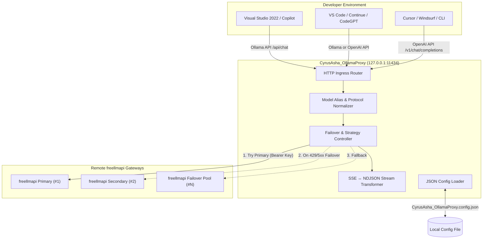
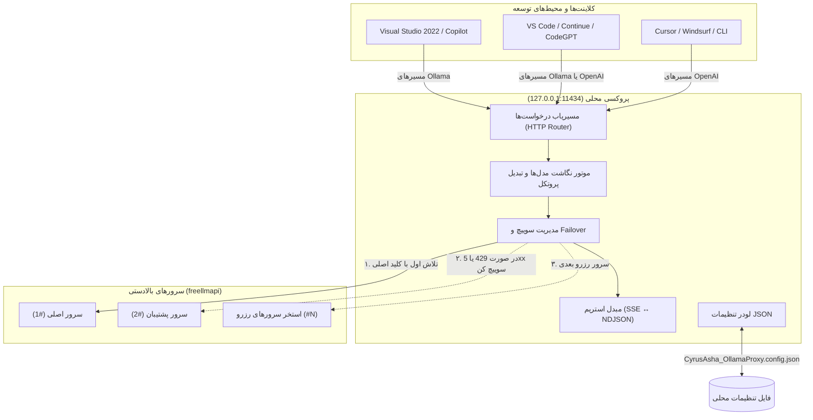

<div align="center">


# CyrusAsha_OllamaProxy

**Code. Intelligence. Order.**

A lightweight, enterprise-grade local **Ollama-** and **OpenAI-compatible** reverse proxy designed for **Visual Studio**, **GitHub Copilot**, **VS Code**, **Cursor**, and AI developer tools. It forwards requests to one or multiple `freellmapi` upstreams with automatic failover, real-time bidirectional stream translation, tool-calling pass-through, and a single, human-readable JSON configuration file.

[](https://nodejs.org/)
[](https://github.com/)
[](LICENSE)
[](#visual-studio--client-setup)
[](#upstreams)
[](#configuration-system)
[](CONTRIBUTING.md)

</div>

<div dir="rtl">

یک پروکسی محلی سبک و حرفه‌ای، سازگار با **Ollama** و **OpenAI**، برای **Visual Studio**، **GitHub Copilot**، **VS Code**، **Cursor** و ابزارهای توسعه‌ی هوش مصنوعی. درخواست‌ها را با failover خودکار، تبدیل زنده‌ی استریم دوطرفه، پشتیبانی کامل از Tool Calling و یک فایل تنظیمات **JSON** خوانا به یک یا چند سرور `freellmapi` می‌فرستد.

</div>

> 🌍 هر بخش در این README دو زبانه است: اول انگلیسی، بعد فارسی. / Every section is bilingual: English first, then Persian.

---

### 📚 Contents / فهرست مطالب

- [Why CyrusAsha_OllamaProxy? / چرا این پروژه؟](#why-cyrusasha_ollamaproxy)
- [Key Features / امکانات کلیدی](#key-features)
- [Architecture / معماری سیستم](#architecture)
- [Requirements / پیش‌نیازها](#requirements)
- [Installation & Quick Start / نصب و اجرای سریع](#installation--quick-start)
- [Configuration System / سیستم تنظیمات](#configuration-system)
  - [Settings Reference / جدول مرجع تنظیمات](#settings-reference)
  - [Upgrading from .env / مهاجرت از .env](#upgrading-from-env)
- [Upstreams / سرورهای بالادست](#upstreams)
- [Model Aliasing / نام مستعار مدل‌ها](#model-aliasing)
- [Supported Endpoints / مسیرهای پشتیبانی‌شده](#supported-endpoints)
- [Visual Studio & Client Setup / راهنمای اتصال کلاینت‌ها](#visual-studio--client-setup)
- [Tool Calling & Streaming / فراخوانی ابزارها و استریم](#tool-calling--streaming)
- [Testing & Verification / آزمون و ارزیابی](#testing--verification)
- [Troubleshooting & FAQ / رفع اشکال و سوالات متداول](#troubleshooting--faq)
- [Security Architecture / معماری امنیت](#security-architecture)
- [Project Structure / ساختار فایل‌های پروژه](#project-structure)
- [Contributing & License / مشارکت و لایسنس](#contributing--license)

---

### Why CyrusAsha_OllamaProxy?

**چرا این پروژه؟ (مسئله و راه‌حل)**

Visual Studio, GitHub Copilot, and modern developer IDEs are designed to interface seamlessly with a **local Ollama instance** (`http://127.0.0.1:11434`) or standard **OpenAI-compatible endpoints** (`/v1/*`).

In enterprise and custom developer workflows, backend LLMs are often provided by external API gateways like `freellmapi` secured with API keys, quota limits, and rate limits. 

**CyrusAsha_OllamaProxy** bridges this gap:
1. **Client Transparency:** Your IDE connects locally to `127.0.0.1:11434` exactly as if a native Ollama or OpenAI service were running.
2. **High Availability & Failover:** Configure multiple `freellmapi` endpoints and keys. If an upstream encounters rate limits (429), quota exhaustion, or server errors (5xx), the proxy transparently retries the next upstream with zero interruption to your editor.
3. **One Readable Config File:** A single `CyrusAsha_OllamaProxy.config.json` holds every setting — upstreams as `{ "url", "key" }` objects and models as a plain JSON array — so there is no long line, no second file, and no sync layer to go wrong.
4. **Agentic Tool Calling Support:** Passes through function calling payloads (`tools`, `tool_calls`, `tool_choice`) intact for modern autonomous coding agents.

---

**🇮🇷 فارسی**

محیط‌های توسعه مدرن از جمله **Visual Studio 2022**، **GitHub Copilot**، **VS Code**، **Cursor** و افزونه‌هایی مانند Continue برای اجرای مدل‌های هوش مصنوعی به‌گونه‌ای طراحی شده‌اند که با یک سرور محلی **Ollama** روی پورت `11434` یا اندپوینت‌های سازگار با **OpenAI** ارتباط برقرار کنند.

در دنیای واقعی و پروژه‌های تیمی، دسترسی به مدل‌های قدرتمند اغلب از طریق درگاه‌های واسط مانند `freellmapi` با کلیدهای API، محدودیت تعداد درخواست (Rate Limits) و سقف مصرف (Quota) فراهم می‌شود.

**پروژه CyrusAsha_OllamaProxy دقیقاً این پل ارتباطی را می‌سازد:**
۱. **شفافیت کامل برای ادیتور:** ابزارهای برنامه‌نویسی شما دقیقاً فکر می‌کنند با یک سرور استاندارد Ollama یا OpenAI محلی صحبت می‌کنند.
۲. **پایداری بالا با Failover خودکار:** چندین آدرس و کلید API تعریف کنید؛ اگر یک سرور به خطای سهمیه (429) یا خطای داخلی (5xx) برخورد، درخواست بلافاصله و بدون متوقف شدن کار شما به سرور بعدی منتقل می‌شود.
۳. **یک فایل تنظیمات خوانا:** همه‌ی تنظیمات در یک فایل `CyrusAsha_OllamaProxy.config.json` است؛ سرورها به شکل آبجکت‌های `{ "url", "key" }` و لیست مدل‌ها به شکل آرایه‌ی واقعی JSON — بدون خط بلند، بدون فایل دوم و بدون همگام‌سازی.
۴. **پشتیبانی از Tool Calling:** ابزارهای خودکار و Agent Mode بدون هیچ مشکلی می‌توانند دستورات Function Calling خود را ارسال و دریافت کنند.

---

### Key Features

**امکانات کلیدی**

| Icon | Capability | Description |
|:---:|---|---|
| 🧩 | **Dual Protocol Emulation** | Fully emulates Ollama endpoints (`/api/chat`, `/api/generate`, `/api/tags`, `/api/show`, `/api/ps`) and OpenAI endpoints (`/v1/models`, `/v1/chat/completions`, `/v1/responses`). |
| ♻️ | **Intelligent Failover** | Automatic multi-upstream failover with `ordered` (priority) or `round-robin` load distribution strategies. |
| 🌊 | **Low-Latency Streaming** | Real-time on-the-fly bidirectional conversion between OpenAI Server-Sent Events (SSE) and Ollama NDJSON streams. |
| 🛠️ | **Native Tool Calling** | Full transparent pass-through of OpenAI function calling arguments and tool execution responses. |
| 🎭 | **Model Aliasing** | Maps custom exposed model names (e.g., `copilot-free:latest`) to upstream target models (e.g., `auto`, `gpt-4o`, `deepseek-chat`). |
| 🔁 | **One JSON Config** | Every setting lives in a single readable `CyrusAsha_OllamaProxy.config.json`: upstreams are `{ "url", "key" }` objects and model lists are real JSON arrays. |
| 🪶 | **Minimalist Footprint** | Pure modern Node.js (ES modules). Zero compilation/build step. Only one lightweight runtime dependency (`dotenv`). |
| 🛡️ | **Enterprise Security** | Binds strictly to localhost loopback (`127.0.0.1`) by default, masks credentials in logs, and isolates Bearer tokens. |

---

**🇮🇷 فارسی**

| آیکون | قابلیت | توضیح |
|:---:|---|---|
| 🧩 | **پشتیبانی دوگانه Ollama و OpenAI** | شبیه‌سازی کامل مسیرهای Ollama (مانند `/api/chat`, `/api/generate`, `/api/tags`, `/api/show`) و OpenAI (مانند `/v1/chat/completions`, `/v1/models`, `/v1/responses`). |
| ♻️ | **Failover و توزیع بار هوشمند** | قابلیت جابه‌جایی خودکار در زمان بروز خطا بر اساس دو استراتژی اولویتی (`ordered`) یا چرخشی (`round-robin`). |
| 🌊 | **استریم سریع و تبدیل فرمت برخط** | تبدیل لحظه‌ای و دوطرفه بین جریان‌های SSE اوپن‌ای‌آی و NDJSON اولاما بدون افت سرعت و بدون نگه‌داشتن داده در حافظه. |
| 🛠️ | **پشتیبانی از Tool Calling** | عبور کامل و دست‌نخورده فیلدهای فراخوانی ابزارها (`tools`, `tool_calls`, `tool_choice`) برای محیط‌های Agentic. |
| 🎭 | **سیستم Model Aliasing** | تغییر نام مدل‌های نمایشی کلاینت (مثل `copilot-free:latest`) به مدل هدف سرور اصلی (مثل `auto`, `deepseek-chat`). |
| 🔁 | **یک فایل JSON** | همه‌ی تنظیمات در یک فایل خوانا به نام `CyrusAsha_OllamaProxy.config.json`؛ سرورها آبجکت‌های `{ "url", "key" }` و لیست مدل‌ها آرایه‌ی واقعی JSON هستند. |
| 🪶 | **سبک و بدون نیاز به Build** | کد خالص مدرن جاوااسکریپت (Node.js ES Modules) با تنها یک وابستگی (`dotenv`) و سرعت اجرای آنی. |
| 🛡️ | **امنیت بومی و پایش محلی** | محدود به Loopback محلی (`127.0.0.1`)، ماسک کردن خودکار کلیدها در لاگ و حفاظت از اطلاعات حساس. |

---

### Architecture

**معماری سیستم**



#### Request Flow:
```text
Client (Copilot)
   │ POST http://127.0.0.1:11434/api/chat
   ▼
CyrusAsha_OllamaProxy
   │ 1. Maps 'copilot-free:latest' -> 'auto'
   │ 2. Translates Ollama payload -> OpenAI payload
   │ 3. Injects 'Authorization: Bearer <KEY>'
   ▼
Upstream #1 (http://127.0.0.1:3001/v1)
   │ ── [429 Quota Exceeded / 502 Bad Gateway] ──▶ Silent Failover
   ▼
Upstream #2 (http://127.0.0.1:3002/v1)
   │ ── [200 OK / SSE Stream] ──▶ Translated to NDJSON Stream
   ▼
Client receives real-time response chunks
```

---

**🇮🇷 فارسی**



#### جریان یک درخواست نمونه:
```text
کلاینت (Copilot)
   │ ارسال درخواست به http://127.0.0.1:11434/api/chat
   ▼
CyrusAsha_OllamaProxy
   │ ۱. ترجمه نام مدل 'copilot-free:latest' به 'auto'
   │ ۲. تبدیل ساختار پیام‌ها از اولاما به اوپن‌ای‌آی
   │ ۳. افزودن هدر 'Authorization: Bearer <KEY>'
   ▼
سرور بالادستی ۱ (http://127.0.0.1:3001/v1)
   │ ── [پاسخ خطای 429 یا خطای شبکه] ──▶ سوییچ بی‌صدا به سرور بعدی
   ▼
سرور بالادستی ۲ (http://127.0.0.1:3002/v1)
   │ ── [پاسخ 200 OK و استریم داده] ──▶ تبدیل زنده SSE به NDJSON
   ▼
کلاینت پاسخ را به صورت لحظه‌ای و کلمه به کلمه دریافت می‌کند
```

---

### Requirements

**پیش‌نیازها**

- **Node.js 18.0.0 or higher** (relies on built-in native `fetch` and `AbortController`).
- One or more running `freellmapi` instances (or OpenAI-compatible providers) with valid API keys.
- Any IDE or client supporting Ollama or OpenAI endpoints (Visual Studio, VS Code, Cursor, Windsurf, curl, etc.).

---

**🇮🇷 فارسی**

- **Node.js نسخه ۱۸.۰.۰ یا بالاتر** (به دلیل استفاده از `fetch` بومی و `AbortController`).
- یک یا چند آدرس سرور `freellmapi` (یا ارائه‌دهنده سازگار با OpenAI) به همراه API Key معتبر.
- نرم‌افزارهای مقصد مانند Visual Studio 2022، VS Code، Cursor، Windsurf یا دستورات ترمینال.

---

### Installation & Quick Start

**نصب و اجرای سریع**

1. **Clone the repository:**
   ```bash
   git clone https://github.com/your-username/CyrusAsha_OllamaProxy.git
   cd CyrusAsha_OllamaProxy
   ```

2. **Install dependencies:**
   ```bash
   npm install
   ```

3. **Create the config file:**
   Copy the example file (or just start the proxy once and it is generated):
   ```bash
   # Windows PowerShell:
   Copy-Item CyrusAsha_OllamaProxy.config.example.json CyrusAsha_OllamaProxy.config.json

   # Linux / macOS:
   cp CyrusAsha_OllamaProxy.config.example.json CyrusAsha_OllamaProxy.config.json
   ```

4. **Configure your upstreams:**
   Open `CyrusAsha_OllamaProxy.config.json` and list your servers — one object each:
   ```json
   {
     "UPSTREAMS": [
       { "url": "http://127.0.0.1:3001/v1", "key": "freellmapi-your-actual-api-key" }
     ]
   }
   ```
   Old keys (`BASE_URLs` + `API_KEY`, `UPSTREAMS_JSON`, `FREELLMAPI_*`) keep working: on the first
   run they are converted into `UPSTREAMS` and removed from the file.

5. **Start the proxy:**
   ```bash
   npm start
   ```

#### Sample Startup Console Output:
```text
🔧 CyrusAsha_OllamaProxy config: CyrusAsha_OllamaProxy.config.json
🦅 CyrusAsha_OllamaProxy listening on http://127.0.0.1:11434 (Ollama + OpenAI compatible)
🤖 Upstream default model: auto
📋 Exposed models: copilot-free:latest
🧭 Model mappings: copilot-free:latest -> auto
🔁 Upstream strategy: ordered
🌐 Upstreams: upstream-1=http://127.0.0.1:3001/v1 key=****f2e4 (len=58)
```
> **Security Note:** Keys are never printed in plaintext; only the length and the trailing 4 characters are shown for verification.

---

**🇮🇷 فارسی**

۱. **کلون کردن مخزن پروژه:**
   ```bash
   git clone https://github.com/your-username/CyrusAsha_OllamaProxy.git
   cd CyrusAsha_OllamaProxy
   ```

۲. **نصب وابستگی‌ها:**
   ```bash
   npm install
   ```

۳. **ساخت فایل تنظیمات:**
   فایل نمونه را کپی کنید (یا فقط یک‌بار سرور را اجرا کنید تا خودش ساخته شود):
   ```powershell
   # در ویندوز پاورشل:
   Copy-Item CyrusAsha_OllamaProxy.config.example.json CyrusAsha_OllamaProxy.config.json

   # در لینوکس / مک:
   cp CyrusAsha_OllamaProxy.config.example.json CyrusAsha_OllamaProxy.config.json
   ```

۴. **تعریف سرورها:**
   فایل `CyrusAsha_OllamaProxy.config.json` را باز کنید و سرورها را لیست کنید — هر سرور یک آبجکت:
   ```json
   {
     "UPSTREAMS": [
       { "url": "http://127.0.0.1:3001/v1", "key": "freellmapi-your-actual-api-key" }
     ]
   }
   ```
   کلیدهای قدیمی (`BASE_URLs` + `API_KEY`، `UPSTREAMS_JSON`، `FREELLMAPI_*`) هم کار می‌کنند؛ در
   اولین اجرا به `UPSTREAMS` تبدیل و از فایل حذف می‌شوند.

۵. **اجرای سرور:**
   ```bash
   npm start
   ```

#### خروجی نمونه کنسول در هنگام اجرا:
```text
🔧 CyrusAsha_OllamaProxy config: CyrusAsha_OllamaProxy.config.json
🦅 CyrusAsha_OllamaProxy listening on http://127.0.0.1:11434 (Ollama + OpenAI compatible)
🤖 Upstream default model: auto
📋 Exposed models: copilot-free:latest
🧭 Model mappings: copilot-free:latest -> auto
🔁 Upstream strategy: ordered
🌐 Upstreams: upstream-1=http://127.0.0.1:3001/v1 key=****f2e4 (len=58)
```
> **نکته امنیتی:** برای امنیت بیشتر، کلیدهای API به صورت کامل در لاگ نمایش داده نمی‌شوند و فقط ۴ رقم پایانی به همراه طول کلید چاپ می‌شود.

---

### Configuration System

**سیستم تنظیمات**

`CyrusAsha_OllamaProxy` reads exactly one file.

| File | Format | Version Control | Description |
|---|---|---|:---:|---|
| `CyrusAsha_OllamaProxy.config.json` | JSON | ❌ Ignored | Your settings. The only file the proxy reads. |
| `CyrusAsha_OllamaProxy.config.example.json` | JSON | ✅ Tracked | Template with safe placeholder values. |
| `.env` | — | — | No longer used. See [Upgrading from .env](#upgrading-from-env). |

The smallest file that works:

```json
{
  "UPSTREAMS": [
    { "url": "http://127.0.0.1:3001/v1", "key": "freellmapi-your-actual-api-key" }
  ],
  "OLLAMA_MODELS": [
    "copilot-free=auto"
  ]
}
```

Every other key has a default (`PORT`, `HOST`, `DEFAULT_MODEL`, `REQUEST_TIMEOUT_MS`, …), so you
only write what you want to change.

#### How Config Loading Works

- **One source of truth.** The proxy reads `CyrusAsha_OllamaProxy.config.json` at startup. Values keep their JSON type: numbers stay numbers and every list is a real array.
- **Defaults for missing keys.** Delete a key and its default applies; nothing is added back behind your back.
- **Shell overrides.** A variable exported in your shell (`PORT=11434`, `UPSTREAMS='[...]'`, `CONFIG_SYNC=off`, …) wins for that run and is never written to the file.
- **Invalid JSON fails loudly.** The proxy exits naming the file and the JSON parser message, and leaves the file untouched.
- **Restart to apply.** Settings are read once at boot, so restart the proxy (`Ctrl+C`, then `npm start`) after editing.
- **Read-only mode.** `CONFIG_SYNC=off` disables writing to the file entirely.

#### Upgrading from .env

Earlier versions kept `.env` and the JSON file in sync; that layer is removed.

- **Old keys inside the JSON file** are converted on the next start: `UPSTREAMS_JSON`, `BASE_URLs` + `API_KEY` and the `FREELLMAPI_*` names all become `UPSTREAMS`, and the old keys are deleted from the file.
- **A `.env`-only setup** is imported once: if the JSON file does not exist and `.env` does, the proxy builds the JSON file from it and renames `.env` to `.env.imported` (kept as a backup, never read again).
- **The long-line problem is gone.** Lists are written and read as real JSON arrays, so `OLLAMA_MODELS` can no longer collapse into one quoted line.

#### Settings Reference

| Key | Default | Description |
|---|---|---|
| `PORT` | `11434` | Local listening port (Ollama's default expected by Copilot). |
| `HOST` | `127.0.0.1` | Bind address. Keep loopback for local security. |
| `UPSTREAMS` | `[]` | **The only place servers are defined.** Array of `{ "url": "...", "key": "..." }`; an optional `"models"` limits the server to those models and an optional `"name"` labels it in logs. Order is the failover order. |
| `UPSTREAM_STRATEGY` | `ordered` | `ordered` (always start at the first entry) or `round-robin` (rotate the starting entry per request). |
| `RETRY_STATUS_CODES` | `[401,403,404,408,409,429,500,502,503,504]` | Status codes that trigger a failover to the next upstream. |
| `DEFAULT_MODEL` | `auto` | Model sent upstream when the requested model has no alias. |
| `OLLAMA_MODELS` | `["auto"]` | Model aliases as `"visible-name=upstream-model"` strings. An object `{ "name": "...", "upstream": "..." }` is also accepted. |
| `ADD_LATEST_TAG` | `true` | Append `:latest` to exposed Ollama model names. |
| `REQUEST_TIMEOUT_MS` | `120000` | Upstream request timeout in milliseconds. |

#### Shell-Specific Control Variables

- `CONFIG_SYNC=off` — read settings without writing the file.
  - PowerShell: `$env:CONFIG_SYNC="off"; npm start`
  - Linux/macOS: `CONFIG_SYNC=off npm start`
  - Windows CMD: `set CONFIG_SYNC=off && npm start`
- `CYRUSASHA_CONFIG_DIR=<path>` — read `CyrusAsha_OllamaProxy.config.json` from another directory.

---

**🇮🇷 فارسی**

پروکسی فقط **یک** فایل می‌خواند.

| فایل | فرمت | وضعیت در Git | توضیح |
|---|---|:---:|---|
| `CyrusAsha_OllamaProxy.config.json` | JSON | ❌ نادیده گرفته می‌شود | تنظیمات شما؛ تنها فایلی که برنامه می‌خواند. |
| `CyrusAsha_OllamaProxy.config.example.json` | JSON | ✅ در مخزن گیت | فایل الگو با مقادیر امن. |
| `.env` | — | — | دیگر استفاده نمی‌شود. بخش [مهاجرت از .env](#مهاجرت-از-env) را ببینید. |

کوتاه‌ترین فایلِ کارآمد:

```json
{
  "UPSTREAMS": [
    { "url": "http://127.0.0.1:3001/v1", "key": "freellmapi-your-actual-api-key" }
  ],
  "OLLAMA_MODELS": [
    "copilot-free=auto"
  ]
}
```

بقیه کلیدها مقدار پیش‌فرض دارند (`PORT`، `HOST`، `DEFAULT_MODEL`، `REQUEST_TIMEOUT_MS` و …)؛
پس فقط چیزی را می‌نویسید که می‌خواهید تغییر دهید.

#### بارگذاری تنظیمات چطور کار می‌کند

- **یک منبع حقیقت.** برنامه در شروع `CyrusAsha_OllamaProxy.config.json` را می‌خواند. نوع مقدارها همان JSON است: عددها عدد می‌مانند و هر لیست یک آرایه‌ی واقعی است.
- **کلیدهای نبوده = پیش‌فرض.** اگر کلیدی را پاک کنید، پیش‌فرضش اعمال می‌شود و چیزی به‌صورت پنهانی به فایل اضافه نمی‌شود.
- **اولویت متغیرهای شل.** متغیری که در ترمینال ست کنید (`PORT=11434`، `UPSTREAMS='[...]'`، `CONFIG_SYNC=off` و …) فقط برای همان اجرا برنده است و هرگز روی فایل نوشته نمی‌شود.
- **JSON نامعتبر = توقف با پیام.** برنامه با نام فایل و پیام خطای JSON می‌ایستد و فایل را دست نمی‌زند.
- **ری‌استارت لازم است.** تنظیمات یک بار هنگام بوت خوانده می‌شود؛ بعد از ویرایش، پراکسی را ری‌استارت کنید (`Ctrl+C` و بعد `npm start`).
- **حالت فقط خواندنی.** `CONFIG_SYNC=off` نوشتن روی فایل را کامل غیرفعال می‌کند.

#### مهاجرت از .env

نسخه‌های قبلی `.env` و فایل JSON را همگام می‌کردند؛ آن لایه حذف شده است:

- **کلیدهای قدیمی داخل فایل JSON** در اجرای بعدی خودکار تبدیل می‌شوند: `UPSTREAMS_JSON`، `BASE_URLs` + `API_KEY` و نام‌های `FREELLMAPI_*` همه به `UPSTREAMS` تبدیل و کلیدهای قدیمی از فایل حذف می‌شوند.
- **تنظیمات فقط با `.env`** یک‌بار منتقل می‌شود: اگر فایل JSON وجود نداشته باشد و `.env` باشد، فایل JSON از آن ساخته می‌شود و `.env` به `.env.imported` تغییر نام می‌دهد (به‌عنوان نسخه پشتیبان می‌ماند و دیگر خوانده نمی‌شود).
- **مشکل خط بلند تمام شده است.** لیست‌ها به شکل آرایه‌ی واقعی JSON نوشته و خوانده می‌شوند، پس `OLLAMA_MODELS` دیگر به یک خط گیومه‌دار تبدیل نمی‌شود.

#### جدول مرجع تنظیمات

| کلید | مقدار پیش‌فرض | توضیح |
|---|---|---|
| `PORT` | `11434` | پورت محلی سرور (پورت پیش‌فرض اولاما). |
| `HOST` | `127.0.0.1` | آدرس bind؛ برای امنیت محلی همان loopback بمانید. |
| `UPSTREAMS` | `[]` | **تنها جای تعریف سرورها.** آرایه‌ای از `{ "url": "...", "key": "..." }`؛ `"models"` اختیاری این سرور را به همان مدل‌ها محدود می‌کند و `"name"` اختیاری در لاگ نمایش داده می‌شود. ترتیب اعضا همان ترتیب failover است. |
| `UPSTREAM_STRATEGY` | `ordered` | `ordered` (شروع از عضو اول) یا `round-robin` (چرخش عضو شروع در هر درخواست). |
| `RETRY_STATUS_CODES` | `[401,403,404,408,409,429,500,502,503,504]` | کدهایی که باعث رفتن به سرور بعدی می‌شوند. |
| `DEFAULT_MODEL` | `auto` | مدل ارسالی به سرور وقتی مدل درخواستی نام مستعار ندارد. |
| `OLLAMA_MODELS` | `["auto"]` | نگاشت مدل‌ها به شکل رشته‌های `"نام-نمایشی=مدل-سرور"`؛ شکل آبجکت `{ "name": "...", "upstream": "..." }` هم پذیرفته می‌شود. |
| `ADD_LATEST_TAG` | `true` | افزودن `:latest` به نام مدل‌ها در اولاما. |
| `REQUEST_TIMEOUT_MS` | `120000` | مهلت زمانی درخواست به سرور (میلی‌ثانیه). |

#### متغیرهای اختصاصی خط فرمان

- `CONFIG_SYNC=off` — خواندن تنظیمات بدون نوشتن روی فایل.
  - ویندوز پاورشل: `$env:CONFIG_SYNC="off"; npm start`
  - لینوکس / مک: `CONFIG_SYNC=off npm start`
  - ویندوز CMD: `set CONFIG_SYNC=off && npm start`
- `CYRUSASHA_CONFIG_DIR=<path>` — خواندن `CyrusAsha_OllamaProxy.config.json` از پوشه‌ای دیگر.

---

### Upstreams

**سرورهای بالادست (Upstreams)**

Every server is one object in the `UPSTREAMS` array — there is no second syntax to learn.

```json
{
  "UPSTREAMS": [
    {
      "name": "primary",
      "url": "http://127.0.0.1:3001/v1",
      "key": "freellmapi-key-1",
      "models": ["auto", "auto:all-glm"]
    },
    {
      "url": "http://127.0.0.1:3002/v1",
      "key": "freellmapi-key-2",
      "models": ["auto:all-gpt"]
    },
    {
      "name": "catch-all",
      "url": "http://127.0.0.1:3003/v1",
      "key": "freellmapi-key-3"
    }
  ]
}
```

- **`url`** — the OpenAI-compatible base URL, including `/v1`.
- **`key`** — sent as `Authorization: Bearer <key>`.
- **`models`** — optional list of the models this server serves. A request is sent only to servers that list its model; a server without `models` accepts every model.
- **`name`** — optional label; logs fall back to `upstream-1`, `upstream-2`, ….

Names in `models` may be the upstream model (`auto:all-glm`) or the exposed alias (`AutoAllGlm`);
matching ignores case and `:latest`. If no server lists the requested model, the proxy logs a warning
and falls back to trying every server, so a typo cannot take a model offline.

With two or more eligible servers, a retryable status (`429`, `5xx`, …) or a network error moves the
request to the next one in list order. Entries without a `url` or `key` are skipped and reported at startup.

---

**🇮🇷 فارسی**

هر سرور یک آبجکت در آرایه‌ی `UPSTREAMS` است — نحو دومی وجود ندارد.

```json
{
  "UPSTREAMS": [
    {
      "name": "primary",
      "url": "http://127.0.0.1:3001/v1",
      "key": "freellmapi-key-1",
      "models": ["auto", "auto:all-glm"]
    },
    {
      "url": "http://127.0.0.1:3002/v1",
      "key": "freellmapi-key-2",
      "models": ["auto:all-gpt"]
    },
    {
      "name": "catch-all",
      "url": "http://127.0.0.1:3003/v1",
      "key": "freellmapi-key-3"
    }
  ]
}
```

- **`url`** — آدرس پایه‌ی سازگار با OpenAI، همراه با `/v1`.
- **`key`** — در هدر `Authorization: Bearer <key>` فرستاده می‌شود.
- **`models`** — فهرست اختیاری مدل‌هایی که این سرور سرو می‌کند. درخواست هر مدل فقط به سرورهایی می‌رود که آن مدل را در فهرست دارند؛ سرور بدون `models` همه‌ی مدل‌ها را می‌پذیرد.
- **`name`** — برچسب اختیاری؛ در لاگ به `upstream-1`، `upstream-2` و … برمی‌گردد.

نام‌های داخل `models` می‌توانند نام مدل سرور (`auto:all-glm`) یا نام نمایشی (`AutoAllGlm`) باشند؛
مقایسه به بزرگی/کوچکی حروف و `:latest` حساس نیست. اگر هیچ سروری مدل درخواستی را اعلام نکرده باشد،
برنامه هشدار می‌دهد و همه‌ی سرورها را امتحان می‌کند تا یک تایپو باعث از کار افتادن مدل نشود.

با دو سرور واجد شرایط یا بیشتر، خطای قابل retry (`429`، `5xx` و …) یا خطای شبکه، درخواست را به
عضو بعدی به ترتیب فهرست منتقل می‌کند. عضو بدون `url` یا `key` نادیده گرفته می‌شود و در شروع گزارش می‌شود.

---

### Model Aliasing

**نام مستعار مدل‌ها (Model Aliasing)**

Certain tools (such as GitHub Copilot or specific IDE extensions) exhibit unexpected behavior or errors if they encounter a raw model identifier named `auto`. 

`CyrusAsha_OllamaProxy` resolves this with alias translation:
```json
{
  "OLLAMA_MODELS": [
    "copilot-free=auto"
  ]
}
```
- **What your client sees:** `copilot-free:latest`
- **What freellmapi receives:** `auto`

#### Multiple Aliases Example:
```json
{
  "OLLAMA_MODELS": [
    "copilot-free=auto",
    "AutoAllGlm=auto:all-glm",
    "AutoAllGpt=auto:all-gpt",
    "claude-local=claude-3-5-sonnet",
    "deepseek=deepseek-coder"
  ]
}
```
One alias per line: add, remove, or reorder a member and save. An object per model works too:
```json
{
  "OLLAMA_MODELS": [
    { "name": "copilot-free", "upstream": "auto" }
  ]
}
```
When a client requests `GET /api/tags`, the proxy lists:
- `copilot-free:latest`
- `claude-local:latest`
- `deepseek:latest`

Each request is automatically routed to its respective upstream model name.

---

**🇮🇷 فارسی**

برخی کلاینت‌ها (مانند GitHub Copilot) اگر نام مدل را به شکل خام `auto` دریافت کنند، دچار رفتار نامناسب یا خطای عدم شناسایی مدل می‌شوند. 

این پروکسی با ویژگی نگاشت مدل این مسئله را رفع می‌کند:
```json
{
  "OLLAMA_MODELS": [
    "copilot-free=auto"
  ]
}
```
- **آنچه کلاینت در منو می‌بیند:** `copilot-free:latest`
- **آنچه به سرور فرستاده می‌شود:** `auto`

#### تعریف چند مدل همزمان:
```json
{
  "OLLAMA_MODELS": [
    "copilot-free=auto",
    "AutoAllGlm=auto:all-glm",
    "AutoAllGpt=auto:all-gpt",
    "claude-local=claude-3-5-sonnet",
    "deepseek=deepseek-coder"
  ]
}
```
یک نام مستعار در هر خط: عضو را اضافه، حذف یا جابه‌جا کنید و ذخیره کنید. شکل آبجکت هم پذیرفته می‌شود:
```json
{
  "OLLAMA_MODELS": [
    { "name": "copilot-free", "upstream": "auto" }
  ]
}
```
با درخواست کلاینت به `/api/tags`، تمامی این مدل‌ها لیست شده و درخواست هر مدل خودکار به مدل واقعی سرور بالادست متصل می‌شود.

---

### Supported Endpoints

**مسیرهای پشتیبانی‌شده (Endpoints)**

#### Ollama-Compatible Endpoints
| HTTP Method | Route | Description |
|:---:|---|---|
| `GET` | `/` | Health check (`Ollama is running`). |
| `GET` | `/api/version` | Returns simulated Ollama engine version (`0.5.0`). |
| `GET` / `POST` | `/api/tags` | Enumerates available models with simulated digests and parameters. |
| `GET` | `/api/ps` | Returns running model processes (returns empty list for compatibility). |
| `POST` | `/api/show` | Returns model architecture details, context window (128k), and tool capabilities. |
| `POST` | `/api/chat` | Chat completions supporting non-streaming and NDJSON streaming. |
| `POST` | `/api/generate` | Text generation completions supporting non-streaming and NDJSON streaming. |

#### OpenAI-Compatible Endpoints
| HTTP Method | Route | Description |
|:---:|---|---|
| `GET` | `/v1/models`, `/models` | Standard OpenAI model list object. |
| `POST` | `/v1/chat/completions`, `/chat/completions` | Standard chat completions with OpenAI SSE stream pass-through. |
| `POST` | `/api/chat/completions`, `/api/v1/chat/completions` | Alternate path aliases for various client libraries. |
| `POST` | `/v1/responses`, `/responses` | OpenAI Responses API endpoint emulation. |

---

**🇮🇷 فارسی**

#### مسیرهای سازگار با Ollama
| متد | مسیر | کاربرد |
|:---:|---|---|
| `GET` | `/` | بررسی زنده بودن سرور (`Ollama is running`). |
| `GET` | `/api/version` | گزارش نسخه اولاما (`0.5.0`). |
| `GET` / `POST` | `/api/tags` | لیست مدل‌های فعال همراه با پارامترها و مشخصات شبیه‌سازی‌شده. |
| `GET` | `/api/ps` | گزارش پردازش مدل‌ها (جهت سازگاری آرایه خالی برمی‌گرداند). |
| `POST` | `/api/show` | نمایش مشخصات فنی، طول کانتکست (۱۲۸ هزار توکن) و پشتیبانی از ابزارها. |
| `POST` | `/api/chat` | مسیر گفتگوی متنی با پشتیبانی از خروجی معمولی و استریم NDJSON. |
| `POST` | `/api/generate` | مسیر تکمیل متن با پشتیبانی از خروجی معمولی و استریم NDJSON. |

#### مسیرهای سازگار با OpenAI
| متد | مسیر | کاربرد |
|:---:|---|---|
| `GET` | `/v1/models`، `/models` | فهرست استاندارد مدل‌های سازگار با OpenAI. |
| `POST` | `/v1/chat/completions`، `/chat/completions` | گفتگوی استاندارد چت با پشتیبانی از استریم SSE. |
| `POST` | `/api/chat/completions`، `/api/v1/chat/completions` | مسیرهای جایگزین برای کلاینت‌های گوناگون. |
| `POST` | `/v1/responses`، `/responses` | شبیه‌سازی مسیرهای OpenAI Responses API. |

---

### Visual Studio & Client Setup

**راهنمای اتصال به Visual Studio و ابزارها**

#### 1. Visual Studio 2022 (GitHub Copilot Local Model)
- Navigate to: **Tools** &rarr; **Options** &rarr; **GitHub** &rarr; **Copilot** (or local model providers).
- Set Endpoint URL: `http://127.0.0.1:11434`
- Set Model: `copilot-free:latest` (or your configured alias).

#### 2. VS Code (Continue Extension / CodeGPT)
In your `~/.continue/config.json`:
```json
{
  "models": [
    {
      "title": "CyrusAsha Proxy",
      "provider": "ollama",
      "model": "copilot-free:latest",
      "apiBase": "http://127.0.0.1:11434"
    }
  ]
}
```

#### 3. Cursor / Windsurf / Custom OpenAI Provider
- **Base URL:** `http://127.0.0.1:11434/v1`
- **API Key:** `local` (or any dummy non-empty string)
- **Model Name:** `copilot-free:latest`

---

**🇮🇷 فارسی**

#### ۱. اتصال در Visual Studio 2022 (مدل لوکال GitHub Copilot)
- از منوی بالا به مسیر بروید: **Tools** &larr; **Options** &larr; **GitHub** &larr; **Copilot** (یا بخش Models).
- آدرس سرور (Endpoint): `http://127.0.0.1:11434`
- نام مدل: `copilot-free:latest` (یا نام مستعاری که تعریف کرده‌اید).

#### ۲. اتصال در VS Code (افزونه Continue یا CodeGPT)
در فایل تنظیمات `~/.continue/config.json`:
```json
{
  "models": [
    {
      "title": "CyrusAsha Proxy",
      "provider": "ollama",
      "model": "copilot-free:latest",
      "apiBase": "http://127.0.0.1:11434"
    }
  ]
}
```

#### ۳. اتصال در Cursor / Windsurf / Freebuff (پروایدر سفارشی OpenAI)
- **Base URL:** `http://127.0.0.1:11434/v1`
- **API Key:** عبارت `local` (یا هر رشته غیرخالی)
- **Model Name:** `copilot-free:latest`

---

### Tool Calling & Streaming

**استریم زنده و فراخوانی ابزارها (Tool Calling)**

#### Real-time Streaming Conversion
- **OpenAI Upstream to Ollama Client:** The upstream produces an OpenAI Server-Sent Event stream (`text/event-stream`). The proxy parses each `data: {...}` chunk and converts it into Ollama NDJSON lines (`application/x-ndjson`), concluding with a `done: true` metadata frame.
- **OpenAI Upstream to OpenAI Client:** The SSE stream passes through untouched with low latency and zero memory accumulation.

#### Tool Calling (Function Calling)
Modern agentic workflows require structured tool invocations. `CyrusAsha_OllamaProxy` preserves:
- Inbound parameters: `tools`, `tool_choice`
- Outbound responses: `tool_calls`, `tool_call_id`, `function`
- Assistant messages with `tool_calls` and `null` content are handled transparently.

---

**🇮🇷 فارسی**

#### تبدیل زنده جریان داده (Streaming)
- **تبدیل خروجی اوپن‌ای‌آی به اولاما:** سرور بالادست خروجی را با فرمت SSE تولید می‌کند (`text/event-stream`). پروکسی هر بسته را لحظه‌ای خوانده، به ساختار استاندارد NDJSON اولاما تبدیل کرده و با تگ پایانی `done: true` به کلاینت تحویل می‌دهد.
- **جریان اوپن‌ای‌آی به اوپن‌ای‌آی:** بسته‌ها بدون ایجاد بافر و با بالاترین سرعت مستقیماً عبور داده می‌شوند.

#### پشتیبانی کامل از Tool Calling
در کدهای خودکار و حالت Agent Mode، مدل نیاز دارد ابزارهای محیطی را صدا بزند. این پروکسی:
- آرگومان‌های `tools` و `tool_choice` ورودی را حفظ می‌کند.
- خروجی‌های `tool_calls`، شناسه‌های تابع و `tool_call_id` را به‌طور دقیق پاس می‌دهد.
- حتی پیام‌های دستیار با محتوای خالی (`null`) که فقط شامل فراخوانی ابزار هستند به درستی مدیریت می‌شوند.

---

### Testing & Verification

**آزمون و ارزیابی**

#### 1. Test Ollama Model Listing:
```bash
curl http://127.0.0.1:11434/api/tags
```
*PowerShell:*
```powershell
Invoke-RestMethod http://127.0.0.1:11434/api/tags | ConvertTo-Json -Depth 5
```

#### 2. Test Ollama Chat (Non-Streaming):
```bash
curl -X POST http://127.0.0.1:11434/api/chat \
  -H "Content-Type: application/json" \
  -d '{
    "model": "copilot-free:latest",
    "stream": false,
    "messages": [{"role": "user", "content": "Explain binary search in one sentence."}]
  }'
```

#### 3. Test OpenAI Route (`/v1/chat/completions`):
```bash
curl -X POST http://127.0.0.1:11434/v1/chat/completions \
  -H "Content-Type: application/json" \
  -d '{
    "model": "copilot-free:latest",
    "messages": [{"role": "user", "content": "Hello!"}]
  }'
```

#### 4. Python SDK Example:
```python
from openai import OpenAI

client = OpenAI(
    base_url="http://127.0.0.1:11434/v1",
    api_key="local"
)

response = client.chat.completions.create(
    model="copilot-free:latest",
    messages=[{"role": "user", "content": "Hello via Python SDK!"}]
)
print(response.choices[0].message.content)
```

---

**🇮🇷 فارسی**

#### ۱. تست دریافت فهرست مدل‌ها:
```bash
curl http://127.0.0.1:11434/api/tags
```
*در پاورشل ویندوز:*
```powershell
Invoke-RestMethod http://127.0.0.1:11434/api/tags | ConvertTo-Json -Depth 5
```

#### ۲. تست چت در مسیر اولاما (بدون استریم):
```bash
curl -X POST http://127.0.0.1:11434/api/chat \
  -H "Content-Type: application/json" \
  -d '{
    "model": "copilot-free:latest",
    "stream": false,
    "messages": [{"role": "user", "content": "یک جمله درباره هوش مصنوعی بگو."}]
  }'
```

#### ۳. تست مسیر سازگار با OpenAI:
```bash
curl -X POST http://127.0.0.1:11434/v1/chat/completions \
  -H "Content-Type: application/json" \
  -d '{
    "model": "copilot-free:latest",
    "messages": [{"role": "user", "content": "سلام!"}]
  }'
```

#### ۴. تست با کتابخانه رسمی OpenAI در پایتون:
```python
from openai import OpenAI

client = OpenAI(
    base_url="http://127.0.0.1:11434/v1",
    api_key="local"
)

response = client.chat.completions.create(
    model="copilot-free:latest",
    messages=[{"role": "user", "content": "سلام از پایتون!"}]
)
print(response.choices[0].message.content)
```

---

### Troubleshooting & FAQ

**رفع اشکال و سوالات متداول**

| Problem | Root Cause | Solution |
|---|---|---|
| `EADDRINUSE: address already in use` | Another process is already occupying port 11434 (e.g., standard Ollama or a zombie Node process). | Find and terminate the process: <br/>• Windows: `netstat -ano \| findstr :11434` followed by `taskkill /PID <PID> /F`<br/>• Linux/macOS: `lsof -i :11434` followed by `kill -9 <PID>` |
| Server boots on an unexpected port | An exported environment variable `PORT` exists in your shell, which overrides config files. | Start explicitly with `PORT=11434 npm start` or unset `PORT` in your shell profile. |
| `All upstreams failed` error | No upstream answered successfully or all returned retryable HTTP codes. | 1. Check your upstream server status (`freellmapi`).<br/>2. Verify the `url` and `key` of every entry in `UPSTREAMS`.<br/>3. Verify network/firewall connectivity to upstream. |
| My `UPSTREAMS` entry is ignored | The entry is missing `url` or `key`, so it is skipped. | Give every entry both fields; skipped entries are reported in the startup log. |
| Model not recognized by Copilot | Model name mismatch between IDE configuration and `OLLAMA_MODELS`. | Verify what `curl http://127.0.0.1:11434/api/tags` outputs and set your IDE to pick that exact model name. |
| `.env` still exists but nothing changes | `.env` is no longer read. | With a `.env`-only setup, one start imports it and renames it to `.env.imported`; otherwise move the values into `UPSTREAMS` yourself. |
| Old `FREELLMAPI_*` or `BASE_URLs` keys in my file | Every server is defined by `UPSTREAMS` now. | Nothing to do — the first run converts them into `UPSTREAMS`, deletes the old keys and logs `🔤 Config migration: …`. |
| App exits with `… is not valid JSON (…)` | A comma, quote, bracket or comment broke the JSON file. | Fix the JSON — standard JSON allows no comments inside arrays or after values. An invalid file is never rewritten, so nothing is lost. |

---

**🇮🇷 فارسی**

| مشکل | دلیل احتمالی | راه‌حل |
|---|---|---|
| خطای `EADDRINUSE` هنگام اجرا | پورت ۱۱۴۳۴ توسط برنامه‌ای دیگر (مانند اولامای اصلی یا اجرای قبلی) اشغال شده است. | پردازش اشغال‌کننده را یافته و متوقف کنید: <br/>• ویندوز: `netstat -ano \| findstr :11434` و سپس `taskkill /PID <PID> /F`<br/>• لینوکس / مک: `lsof -i :11434` و سپس `kill -9 <PID>` |
| سرور روی پورت اشتباه بالا می‌آید | متغیر `PORT` در محیط ترمینال شما ست شده و بر تنظیمات فایل اولویت دارد. | برنامه را با دستور `PORT=11434 npm start` اجرا کنید یا متغیر را از شل خود حذف کنید. |
| خطای `All upstreams failed` | سرور بالادست پاسخ نداده یا کلیدها منقضی شده‌اند. | ۱. از روشن بودن سرور بالادست مطمئن شوید.<br/>۲. `url` و `key` همه‌ی اعضای `UPSTREAMS` را بررسی کنید.<br/>۳. اتصال اینترنت یا شبکه محلی را ارزیابی کنید. |
| یکی از اعضای `UPSTREAMS` نادیده گرفته می‌شود | آن عضو `url` یا `key` ندارد و رد می‌شود. | هر دو فیلد را برای همه‌ی اعضا بنویسید؛ عضوهای ردشده در لاگ شروع گزارش می‌شوند. |
| کوپایلوت مدل را شناسایی نمی‌کند | نام مدل انتخابی در ادیتور با نام‌های تعریف شده در `OLLAMA_MODELS` همخوانی ندارد. | خروجی `curl http://127.0.0.1:11434/api/tags` را ببینید و همان نام (با یا بدون `:latest`) را در کلاینت وارد کنید. |
| فایل `.env` هنوز هست ولی چیزی عوض نمی‌شود | `.env` دیگر خوانده نمی‌شود. | اگر تنظیمات فقط در `.env` باشد، یک بار اجرای برنامه آن را منتقل و به `.env.imported` تغییر نام می‌دهد؛ وگرنه مقدارها را خودتان به `UPSTREAMS` منتقل کنید. |
| در فایلم هنوز `FREELLMAPI_*` یا `BASE_URLs` هست | همه‌ی سرورها با `UPSTREAMS` تعریف می‌شوند. | کاری لازم نیست؛ اولین اجرا آن‌ها را به `UPSTREAMS` تبدیل و کلیدهای قدیمی را حذف می‌کند و پیام `🔤 Config migration: …` چاپ می‌شود. |
| پیام `… is not valid JSON (…)` | یک ویرگول، گیومه، براکت یا کامنت JSON را خراب کرده است. | JSON را درست کنید؛ JSON استاندارد کامنت داخل آرایه یا بعد از مقدار را قبول نمی‌کند. فایل نامعتبر هرگز بازنویسی نمی‌شود. |

---

### Security Architecture

**معماری امنیت**

- **Strict Localhost Binding:** The proxy binds exclusively to `127.0.0.1` by default. It is not exposed to external LAN/WAN interfaces unless `HOST` is deliberately modified.
- **Credential Protection:** Secrets (`CyrusAsha_OllamaProxy.config.json` and the `.env.imported` backup) are strictly ignored in `.gitignore`.
- **Log Masking:** Logs redact API keys, printing only the trailing 4 characters and string length (`****abcd`).
- **Token Isolation:** API keys are injected solely into the outbound HTTP `Authorization` header targeted at configured upstreams.
- Read our [SECURITY.md](SECURITY.md) and [THREAT-MODEL.md](THREAT-MODEL.md) for detailed policies.

---

**🇮🇷 فارسی**

- **محدودیت به Loopback محلی:** پروکسی فقط روی `127.0.0.1` گوش می‌دهد و بدون تنظیم دستی `HOST`، از شبکه خارجی قابل دسترسی نیست.
- **جلوگیری از نشت کلیدها:** فایل‌های حساس شامل `CyrusAsha_OllamaProxy.config.json` و نسخه پشتیبان `.env.imported` به طور قطعی در `.gitignore` نادیده گرفته شده‌اند.
- **ماسک کردن در لاگ:** کلیدهای API هرگز به صورت خام در ترمینال چاپ نمی‌شوند (`****abcd`).
- **جداسازی توکن‌ها:** کلیدها فقط به عنوان هدر استاندارد `Authorization: Bearer` به سرورهای تعریف‌شده شما فرستاده می‌شوند.
- برای اطلاعات تفصیلی، اسناد [SECURITY.md](SECURITY.md) و [THREAT-MODEL.md](THREAT-MODEL.md) را مطالعه فرمایید.

---

### Project Structure

**ساختار فایل‌های پروژه**

```text
CyrusAsha_OllamaProxy/
├── src/
│   ├── CyrusAsha_OllamaProxy.js          # Core HTTP server, routing, streaming & failover logic
│   └── config.js                         # Single-file JSON config loader & legacy migration
├── assets/
│   └── CyrusAsha-logo-withoutBG.png      # Official project logo & social preview
├── CyrusAsha_OllamaProxy.config.example.json # Template for the JSON configuration
├── .gitignore                            # Git exclusion rules (safeguarding secrets & caches)
├── package.json                          # Project manifest & metadata
├── LICENSE                               # MIT License
├── README.md                             # Comprehensive bilingual documentation
├── SECURITY.md                           # Vulnerability disclosure & security policy
├── THREAT-MODEL.md                       # STRIDE threat model & boundary analysis
├── SECURITY-CHECKLIST.md                 # Pre-release security verification checklist
└── CONTRIBUTING.md                       # Contribution guidelines & development workflow
```

---

**🇮🇷 فارسی**

```text
CyrusAsha_OllamaProxy/
├── src/
│   ├── CyrusAsha_OllamaProxy.js          # هسته اصلی سرور، مسیریابی، تبدیل استریم و سوییچ سرور
│   └── config.js                         # لودر تنظیمات JSON و مهاجرت خودکار کلیدهای قدیمی
├── assets/
│   └── CyrusAsha-logo-withoutBG.png      # لوگوی رسمی و تصویر پیش‌نمایش شبکه اجتماعی
├── CyrusAsha_OllamaProxy.config.example.json # فایل الگوی تنظیمات
├── .gitignore                            # قوانین نادیده گرفتن فایل‌های حساس و کش‌ها در گیت
├── package.json                          # شناسه پروژه و وابستگی‌ها
├── LICENSE                               # مجوز پروژه (MIT License)
├── README.md                             # مستندات جامع دو زبانه (فارسی و انگلیسی)
├── SECURITY.md                           # شیوه‌نامه امنیت و گزارش آسیب‌پذیری‌ها
├── THREAT-MODEL.md                       # مدل تهدیدات امنیتی (STRIDE) و مرزهای اعتماد
├── SECURITY-CHECKLIST.md                 # چک‌لیست بررسی‌های امنیتی قبل از انتشار
└── CONTRIBUTING.md                       # راهنمای مشارکت در پروژه و ارسال Pull Request
```

---

### Contributing & License

**مشارکت و لایسنس**

Contributions, bug reports, and suggestions are welcome! Please check [CONTRIBUTING.md](CONTRIBUTING.md) before opening a pull request.

This project is licensed under the **MIT License**. See the [LICENSE](LICENSE) file for details.

**Built with pride by CyrusAsha** — *Code. Intelligence. Order.*

---

<div dir="rtl">

---

**🇮🇷 فارسی**

از ارسال پیشنهادات، گزارش باگ‌ها و Pull Requestها استقبال می‌شود. لطفاً پیش از ارسال، راهنمای [CONTRIBUTING.md](CONTRIBUTING.md) را بررسی کنید.

این پروژه تحت مجوز **MIT License** منتشر شده است. اطلاعات بیشتر در فایل [LICENSE](LICENSE) موجود است.

**ساخته‌شده با افتخار توسط CyrusAsha** — *Code. Intelligence. Order.*

